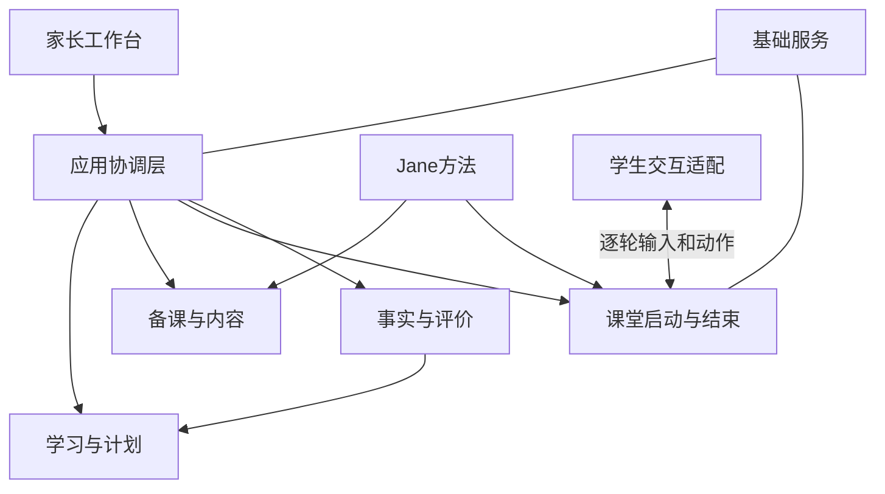

# Project J 模块设计入口

版本：1.10.1；更新：2026年10月12日；阶段：产品与模块设计。

J以家长工作台和学生课堂为入口，采用八个职责模块与一个显式应用协调层。模块是应用内部边界，不要求独立服务或多个Agent。共同含义、规范权威、当前阶段和真实数据范围统一见[shared](shared/README.md)。

## 组件与职责

| 目录 | 维护什么 | 主要结果 |
| --- | --- | --- |
| [application](application/README.md) | 跨模块用例、操作进度与接续、验收汇总 | 可恢复的业务操作和实际处理结果 |
| [learning](learning/README.md) | 档案、全学科状态、目录、长期至近期计划 | 选定需求、状态/计划修订、复盘 |
| [teacher](teacher/README.md) | 唯一Jane的通用规则、学科/课型策略与迭代 | 有范围和版本的教学方法 |
| [preparation](preparation/README.md) | 核实任务、素材、简报、预览与备课完成 | 可执行课程包及必需条件 |
| [curriculum](curriculum/README.md) | 资料/资源/模板/课程、固定依赖与更正 | 可复用且可回查的内容版本 |
| [classroom](classroom/README.md) | 本次启动结论、教学核心/Harness、当前活动 | 允许动作、实际事件与结束边界 |
| [evaluation](evaluation/README.md) | 结束封存事实、反馈、评价/对照与更正 | 有据解释、候选建议及改进问题 |
| [interface](interface/README.md) | 家长/学生视图、输入提交、交付和设备适配 | 统一输入、允许呈现与真实反馈 |
| [platform](platform/README.md) | 模型/语音/素材、权限、同步、保存和故障能力 | 实际技术结果及保存回执 |
| [shared](shared/README.md) | 跨模块共同合同和执行规则 | 文档规范，不是运行组件 |

## 完整使用流程

| 步骤 | 家长 | 孩子 | AI与应用 |
| --- | --- | --- | --- |
| 准备下一课 | 提出近期意图或使用已确认目标，补必要条件 | 可表达兴趣 | learning选定需求，备课生产核实任务/素材/简报 |
| 预览与必要决定 | 看目标/材料/帮助和缺口，决定重要变化 | 按许可查看安排 | 内容固定，解释理由及实际就绪范围 |
| 本次检查与开始 | 报告实物/时间等事实，明确开始 | 准备参与 | 汇集依据，classroom按判定规则开始或返回缺口 |
| 互动和离屏 | 陪伴，必要时报告帮助或接手/停止 | 尝试、求助、操作、报告 | 适配器自动提交；核心判断/指导/纠错，平台交付 |
| 结束封存 | 可当时离开或补反馈，查看保存结果 | 小结或请求结束 | 停止教学与采集，保存已有事实；不等家长总结 |
| 反馈与评价 | 当时/稍后一段实际补充，可无额外补充 | 可表达体验 | 追加原来源，评价/更正，解释课堂与备课差异 |
| 更新下一课 | 了解调整，决定重要方案 | 后续活动继续验证 | 按有据范围保存状态/计划/需求，备课并呈现实际结果 |
| 周阶段年度复盘 | 主动或从工作台发起，选择重要方向 | 随能力参与反思 | 汇总跨课证据，分层调整计划与Jane策略，失败原操作接续 |

本表只导航；具体保存、按需评价触发/复用和继续条件以[共同执行](shared/execution-recovery.md)为准，个人对象按[学习者归属](learning/profile.md#学习者归属与扩展边界)隔离。实现先按[E2E01](shared/end-to-end-cases.md)跑通命名对象链，异常和使用资格分别验收。

## 现有文件与未来代码

design存设计；courses存课程及素材；project_j、web、scripts和tests保留0.1实验原型。应用协调层有明确逻辑归属，最终代码目录、数据库和技术栈随实现方案确定。开发从根[AGENTS](../AGENTS.md)和本入口按任务读取，不把完整档案、所有历史或全部设计送进每轮课堂模型。
