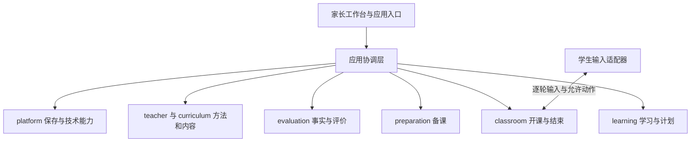

# 应用协调层

版本：1.1.0；更新：2026年10月12日；范围：组件设计与P0映射。

应用协调层是 J 内部有明确归属的执行组件，位于界面入口与八个模块之间。它维护跨模块操作进度、组织调用和失败接续；八模块保留各自对象与业务判断。组件不要求独立服务、队列系统或额外 Agent，最终代码位置随技术方案确定。

涉及继续条件的“关键”与阻断判定，统一采用[共同阻断标准](../shared/business-contracts.md#关键阻断的共同标准)。

## 组件边界

应用层负责用例的顺序、版本和进度，不另建学习状态、评分规则或课堂状态机。逐轮互动由适配器直接接课堂核心；应用协调不成为每轮额外模型调用或全链规划。shared保存共同定义，本目录说明执行组件如何采用它们。

## 用例入口和执行者

| 用例 | 触发与主责 | 完成结果及失败接续 |
| --- | --- | --- |
| 准备下一课 | 家长请求；learning生成/复核需求，preparation生产，curriculum固定内容 | 可获取的包与核验结果；缺口或待决定保持原操作，修复后续做 |
| 本次开课 | 家长请求；应用层收齐依据，classroom作启动判定 | 绑定的活动与内存状态；不合格返回原因/替代，不建立正在教学的活动 |
| 结束并封存 | classroom发出正常结束、未确认结束、明确停止或可控中断事件 | evaluation接收事实，platform保存；不等模型或家长反馈；保存未知先查原操作 |
| 提交反馈与评价 | 家长当时/稍后提交；evaluation追加来源及评价 | 学习更新、需求及报告的实际结果；从失败步骤接续 |
| 基于封存事实按需评价 | 已封存且家长明确稍后反馈，准备下一课或工作台当前用途确需评价；应用层按[触发与复用规则](../shared/execution-recovery.md#阶段性评价的按需触发)接续 | evaluation只解释证据支持范围；已有适用结果复用，封存本身不触发模型 |
| 更正事实或内容 | 原维护者接收更正；evaluation/learning等回查依赖 | 原来源保留、解释新修订和影响处理；不重放旧课堂输入 |
| 周阶段年度复盘 | 家长主动发起，或从工作台发现到期后的入口发起 | learning维护复盘结果与计划；重大变更交具体方案，其余按授权落实 |
| 处理待决定方案 | 家长选择绑定版本；方案提出模块复核并落实 | 决定与实际生效分开；过期/冲突回原维护者，不覆盖新状态 |
| 组织验收与使用资格 | 开发/验收操作；各模块提交证据 | 应用层维护[验收报告](acceptance.md)，classroom消费有效使用范围 |

执行顺序和业务继续条件统一在[execution-recovery.md](../shared/execution-recovery.md)，复盘细节在[plan-review.md](../learning/plan-review.md)。模块返回可用结果、缺口、阻断范围和后续动作；协调层按共同规则执行，不以大模型临时猜哪个缺口可忽略。

## 操作状态和保存边界

每个用例有稳定操作身份、触发者、来源修订、目标对象、预期基线、步骤输入/结果、保存回执及下一步。状态区分受理、运行、待输入/决定、失败可接续、取消、部分完成和完成；这些是执行状态，不代表孩子学习状态。

备课、开课前检查、结束后的封存/反馈/复盘操作可以保存进度。进入教学后只维护必要内存；预存的开课请求不证明课堂已发生，也不持续追加活动快照。结束封存按共同执行规则写入允许事实。封存与操作台账分开失败时，可根据原活动/封存操作查询已存结果，不重复创建事实。进程丢失后只有预存开课请求时，将实际运行与结束标为未知。

同一操作/来源修订重试复用成功结果；新的反馈或更正另有修订联系。只重试技术可重试步骤，并有次数/期限和可见下一步；等待家长、业务阻断、内容错误不靠盲目重试解决。取消备课或复盘保留已保存合法结果，停止课堂则优先即时停采集/播放/教学，封存独立接续。

同一学习者的状态/计划/需求更新，以及同一活动的来源修订，发布前核对预期版本；并发生成可以存在，但冲突结果先重新读取并复核。旧请求不能覆盖后来的依据，双击或网络重发不能计双份样本。具体锁和事务技术以后选择，这些行为是实现约束。

## 交付和恢复

界面从协调结果显示已完成什么、哪一步待处理及可做什么。业务模块负责解除自己提出的限制；应用层核对对应结果和版本，不能自行把未知改为通过。报告生成失败不撤销已经保存的事实或有效状态；一项候选改进未完成不阻断无关课程。

必要进度在用户继续原操作、重新打开工作台或明确重试时接续，首版不依赖后台定时任务。测试从[完整时序与异常案例](../shared/end-to-end-cases.md)取得预期；当前实现与数据权威统一见[共同入口](../shared/README.md)。

## P0到阶段1的映射

阶段1代码落在project_j/python的application用例服务，按[请求/步骤/保存合同](../shared/execution-recovery.md#p0操作身份保存与有限接续)维护进度；模块返回有范围的业务回执。用例先运行一个明确保存单位再进入下一个，不持有数据库事务等待模型，不把每轮交互包装成跨模块工作流。对象和课堂守卫使用[最小字段](../shared/business-contracts.md#p0最小对象字段与版本关系)，课程包/简报的内容合同仍归preparation。

P0提供合同校验、延迟分析和受控模型探针；完整数据库、活动状态机、协调器、备课/评价采用和可操作薄界面均未实现。阶段1切片及依赖见[路线](../../docs/roadmap.md#阶段1的内部顺序)，必须完成C2及其自身核验，不能以REP1或N1作为闭环终点。
