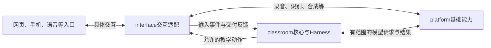

# 课堂核心、交互层与统一交接

文档版本：1.3.0；更新：2026年10月12日；范围：逻辑设计，未实现。

classroom管理教学含义与本堂状态，interface管理交互适配，platform提供技术能力。网页、手机、纯语音或未来其他入口可接入同一课堂核心。

## 职责边界

| 部分 | 负责 | 不代替的职责 |
| --- | --- | --- |
| classroom核心与Harness | 任务与阶段、输入含义、依据本题判断、允许教学动作、帮助条件、预算、转场与结束 | 不录音、操作按钮、排版、转写、合成或直接播放声音 |
| interface交互适配 | 接收实际输入/操作、调用基础交互能力、整理统一事件、呈现允许动作、回报实际交付 | 不另建评分、进阶、帮助升级或课堂转场规则 |
| platform基础能力 | 模型调用、录音/识别/合成、视觉与素材能力、取消、计时、访问与存储状态 | 技术成功不代表内容正确、学生收到或教学就绪 |
| teacher与preparation | Jane方法、核实内容、具体任务/支架与本课简报 | 不逐轮操作界面；Jane仍是唯一教师 |

课堂需要模型判断时可通过platform调用相应能力，不要求绕经界面。输入、教学动作、交付反馈是统一的业务交接，不要求新增模块、独立服务或额外Agent。语音入口也须服从相同教学动作与停止边界，不能另有绕过Harness的教学流程。

## 统一输入事件

输入保留实际内容或可获取引用、来源、提供者与角色、接收时间、所属会话/任务、事件标识和当前上下文联系。必要时注明原始输入与识别文本的区别、实际识别限制或家长代述；未知角色/来源/识别情况不得补成儿童独立表现。

| 输入类别 | 内容与处理 |
| --- | --- |
| 回答或作品 | 文字、语音识别结果、图片/作品引用或实际动作报告；按当前任务理解，保留原答 |
| 控制请求 | 开始、重复、求助、跳过、暂停、恢复、停止；按钮含义明确，自然表达由核心结合上下文理解 |
| 确认或补充 | 实际收到目标/小结的确认、条件说明、对识别文本的更正、家长帮助报告 |
| 运行事件 | 实际计时、能力变化、识别/模型失败、中断；不是学习答案或学生失败 |

interface不必须先替课堂判断自然语言意图；“我不知道”“还是没懂”“听到了”由核心按当前等待对象处理。输入含糊或同时涉及多个意图时必要澄清，明确停止优先。识别中的片段不自动提交为完整答案，也不要求家长每轮手工转交；完成边界、自动提交和更正按[输入提交规则](../interface/input-submission.md)，由interface适配器负责，核心核对已提交事件。

## 统一教学动作

动作包含所属会话/任务、动作标识与状态联系、教学目的、允许内容/素材版本、呈现对象、执行顺序或必要条件、下一步等待对象及失败/取消路径。它可以是提问、反馈、解释、提示/示范、呈现材料、进入离屏、等待、暂停、恢复、正常收尾或停止。

教学内容及措辞按Jane与课程范围生成；interface可以适配布局、字号、朗读等表现，不能自行改知识含义、题意、答案、帮助程度或接续条件。单轮可含短反馈加一个问题，始终保持一个清楚的回应目的；内部简报与答案不交学生后再隐藏。

## 统一交付反馈

反馈连接实际动作、内容版本、对象与媒介，区分开始、部分完成、完成、失败、取消和被打断；必要时注明已交付/未交付范围，例如目标只播到前半段。interface汇总实际呈现，platform提供技术结果，classroom据此决定重试、备用、继续或暂停。

模型提出动作、Harness允许动作、界面执行、设备完成播放、学生实际收到与表现出理解分别记录。技术反馈不能自动生成“听到了”，实际确认由输入事件取得，也不证明学会；不能对每个普通动作强加确认，按课程必要条件处理。

具体适配按[界面输入输出](../interface/input-output-adapters.md)取得来源/角色、真实提交与呈现范围；自然输入不逐句委派，角色标签不直接证明作答者。按[角色/设备](../interface/roles-devices.md)核对当前输入/语音输出与材料许可，暂停/停止本端取消与核心同步分别报告，断网不能把本端状态当全会话结束。

## 一致性与入口扩展

- 事件按身份防重复，不能按回答文本去重；两次真实说同一句话可能是不同尝试。
- 普通答案、模型结果与反馈须核对当前会话/任务/动作及适用状态；过期结果不推进或呈现。重发同一事件不再计一次表现。
- 针对当前会话的明确停止/暂停走优先控制路径，不等待教学模型；interface/platform立即取消本地录音、播放与等待，并同步核心状态。过期教学结果不得撤销停止。
- 识别文本更正连接原事件及实际顺序，不覆盖原答，也不把同一次发言变成新独立样本；若已推进则核对受影响任务，不能静默套入下一题。
- 新入口声明实际输入/输出、取消、材料与反馈能力，按[启动设计](session-start.md)核对任务需要；输入媒介改变可能改变评价条件，不能一律视为等价。
- 课中事件及必要媒介内容仅保留本堂必要内存，结束时按[共同封存规则](../shared/execution-recovery.md)保存。默认不保存儿童原始音频，不以统一事件增加监控或快照。

互动与异常见[interaction-harness.md](interaction-harness.md)、[time-exceptions.md](time-exceptions.md)，最终事实与交接见[closing-handoffs.md](closing-handoffs.md)。

[基础服务交接](../platform/handoffs.md)提供同活动/任务/动作的实际结果、版本、权限、期限和取消；[语音路径](../platform/realtime-voice.md)把完成输入自动送核心，批准教学文本后合成，未允许片段不先发声。核心仍是状态权威，技术会话与教学活动分开，实际交付不自动确认收到。
