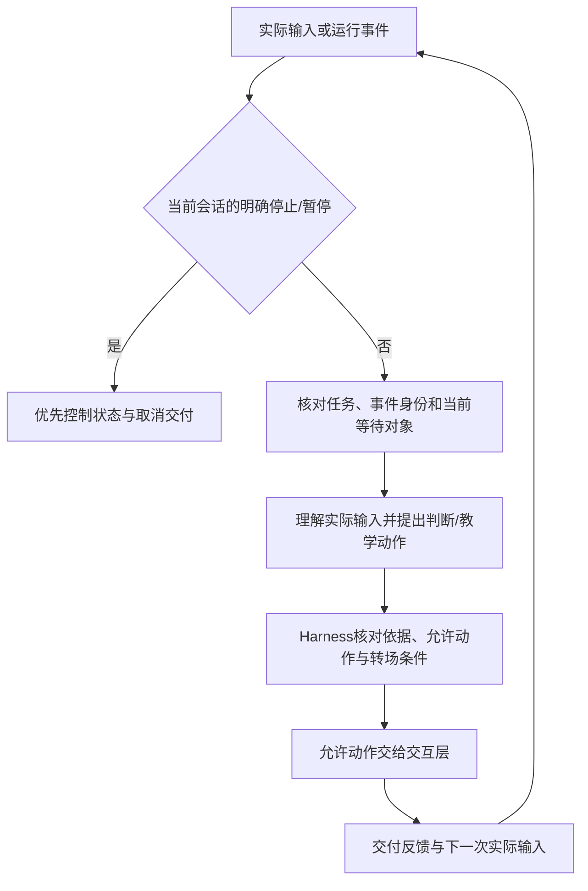

# 实时互动与Harness边界

文档版本：1.0.0；更新：2026年10月12日；范围：逻辑设计，未实现。

孩子的自然回应通过[统一事件](boundaries-events.md)进入课堂核心，应用连续接续，家长不逐句委派或逐题批准。Harness约束状态、动作与转场，模型在本课允许范围内理解、判断和指导；不要求每题重新备课或调用额外教师Agent。

## 单轮处理

模型取得当前任务、核实依据、相关简报、原答/帮助和允许路径的紧凑上下文。提案须说明对应输入、判断依据、无法判断项、教学动作及下一步；模型请求由platform提供能力，教学允许性仍归classroom。

Harness检查会话/任务一致、当前动作许可、目标/答案/独立条件、材料可见性、帮助与预算、确认和退出条件。语义依据不足、模型越界或结果格式失败时不推进任务，使用已准备澄清/备用/暂停路径。程序能检查边界，不能仅凭格式保证事实正确或教学有效。

## 回应分支

| 实际输入 | 本轮处理 |
| --- | --- |
| 正确或合理变式 | 按本题依据反馈；观察阶段遵守反馈时机，不泄露后续样本 |
| 有依据的错误 | 核对识别/要求，指出具体不对应，支持后再试，保留初答 |
| 不知道或求助 | 按困难选择实际指导，重复无效换方法、升级或允许退出 |
| 题意/输入不清 | 简短澄清或换允许表达方式，未知不默认错误 |
| 重复题干/跟读 | 只有相应任务才算跟读，其他任务澄清所需回应，不自动完成 |
| 目标/小结确认 | 对应实际说明与当前等待对象处理，确认收到不等于知识掌握 |
| 指认/离屏报告 | 按来源和任务条件处理结果与帮助，不猜动作，不代填答案 |
| 重复/跳过/恢复 | 作为控制请求执行相应路径；重复呈现是否构成帮助按内容与条件判断 |
| 新话题/要求挑战 | 简短接住兴趣，使用已准备且条件适合的分支，其他留给后续备课 |

需要多个处理意图时先明确停止/暂停，再核对其他意图；求助、控制和普通附和不能统一当作学习答案。判断与帮助细节见[guidance-correction.md](guidance-correction.md)。

## 连续接续与交付

一轮保持一个清楚的回应目的，可有短反馈/解释及一个实际问题。确认、恢复或转场满足后，应直接发出下一项允许动作；不出现“开始复习”后没有任务、需要家长催促的交接空档。

无需学生回答的内部步骤，由应用在条件满足后继续执行有限的允许动作；需要回答时等待实际输入，不能自行补答案或让模型虚构新事件。实际交付、超时和故障反馈由对应层提供，不因没有新聊天消息就假定孩子沉默或超时。

交付失败时保留已交付范围和原判断，用核实方式补交或暂停；不能从失败生成内容推断孩子看到/听到，也不能自动把原答再次评分。重复交付和再次真实作答分别关联。部分交付或被打断后的回答按实际条件处理，必要时核对听到范围。

## 防重复、迟到与停止

同一事件/动作重试保持身份，防重复推进；真实再次回答即使文本相同也不是技术重复。并发结果提交前核对当前状态，先前任务结果、已取消音频/素材与停课后返回不得改变课堂。

停止/暂停无需等待普通教学判断；interface/platform立即取消可控交付，核心同步状态并使待完成教学动作失效。已在远端运行的请求可能仍返回，结果不得播放或撤销停止。自然语言停止在取得明确意图后同样优先，识别含糊时保留可立即操作的控制入口。

运行中只维护本堂必要内存，不监控其他任务、写文件或运行项目检查。结束且家长一次反馈后按[交接](closing-handoffs.md)统一整理，正常收尾与明确停止分别记录。
