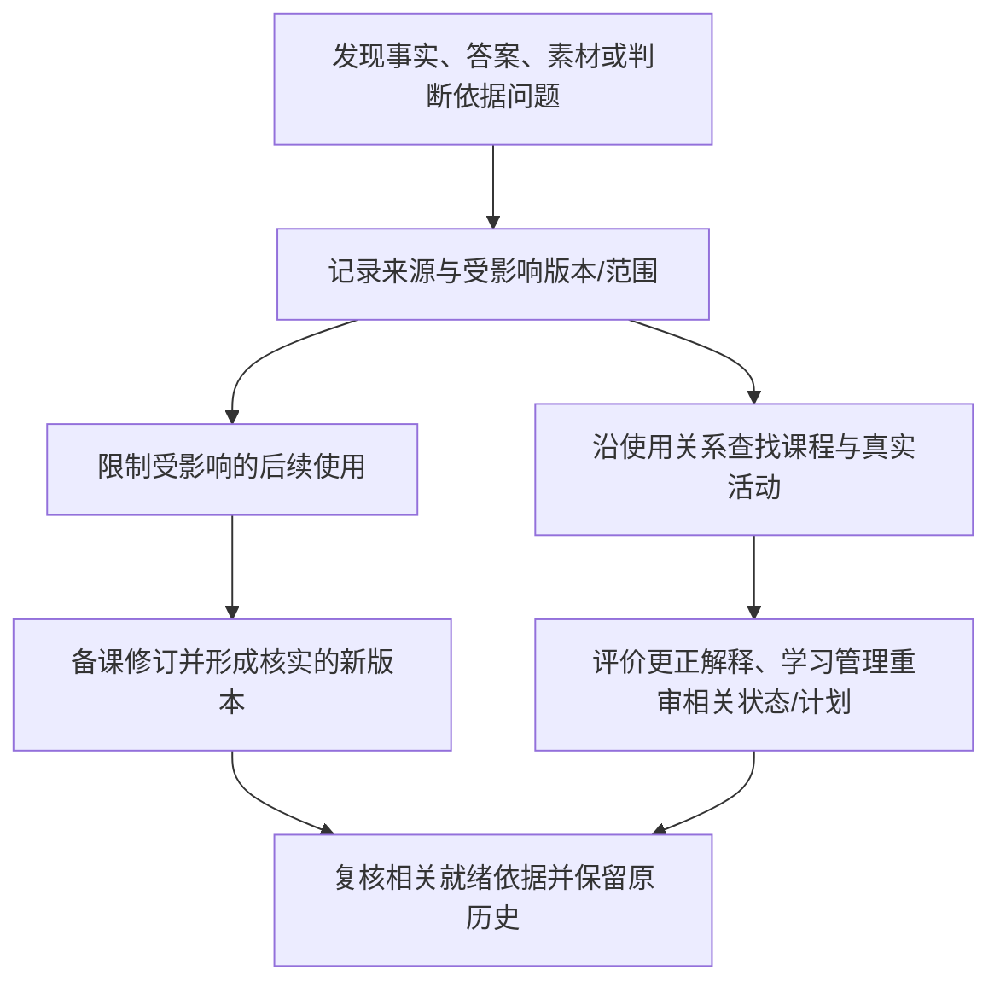

# 历史保存与内容更正

文档版本：1.0.0；更新：2026年10月12日；范围：逻辑设计，未实现。

历史让家长和AI知道某次课堂用过什么、根据什么评价，以及后来为何更正。curriculum保存内容及修订关系，evaluation维护真实活动和评价，learning维护状态与计划；原始事实和新的解释分别保留。

## 需要保留的内容

- 被使用的课程版本、任务、答案依据、素材、Jane/策略与本课简报及必要依赖。
- 当时核验/备课完成范围、来源与适用条件，关联本次实际启动和使用记录。
- 派生、替代、停用、归档、更正及其原因、范围和后续处理。
- 指向真实活动/修订的使用关系；活动的日期、原答、帮助和结束仍以evaluation为准。

课程使用多次时连接各自记录，不把课程标成永久完成。一个活动引用多个资源或学科不增加样本次数；后续补充或更正链接到原活动修订，不创建新的学习日期。

## 归档、缺失与恢复

归档只改变常用入口，不默认删除旧内容或必需依赖。停用限制未来选择/执行，历史仍可访问并显示原因；当前界面不能以“旧版”标签隐藏已知错误或缺失。

不能自动按文件后缀、版本过旧或无近期使用删除历史必需材料。是否清理、备份和具体存储由后续维护方案处理；未经针对该操作授权不丢弃记录或改写Git历史。

外部链接或素材缺失时，标明缺失范围及其对核验/评价的影响。只有恢复到可确认的原内容才恢复相应可回查性；重新生成或新取得的近似内容是另一个来源/版本，不冒称原件。

现场素材按[呈现与生成边界](presentation-resources.md)在结束反馈后整理，不增加课中监控、屏幕快照或原始音频归档。重启丢失的实际内容保持未知，不能用教案填补已发生表现。

## 更正流程

| 步骤 | 责任与输出 |
| --- | --- |
| 1. 保存问题 | 实际来源、原内容、发现日期、问题事实/假设与涉及对象；疑点未确认保持待核实 |
| 2. 判断影响范围 | preparation核对内容，curriculum连接依赖与使用；明确哪些任务/版本/检查受影响，不一律停全部课程 |
| 3. 限制未来使用 | 已知关键错误不能继续用于相应教学/评价；限制或停用有范围与原因，未核实关键疑点按适用风险暂停相关部分 |
| 4. 修订内容 | preparation修复材料/任务/答案/简报，形成新版本与检查；固定原内容不静默覆盖 |
| 5. 回查真实结论 | evaluation基于原答、实际帮助和更正依据修订解释，learning重审依赖状态与未来计划，保留旧结论及更正说明 |
| 6. 复核与报告 | 核对受影响的备课/启动依据，向家长说明改了什么、影响哪些结论及仍未知部分，不把更正记为新表现 |

纠正文案或外观也要判断是否影响语义、声音、可见答案或条件；真正无影响的检查可复用。不能只修改未来答案而继续保留基于错误依据的状态，也不能因为内容错误将学生原回答改写成另一个答案。

## 课堂与判断边界

课堂发现关键问题时，按已准备的澄清/跳过/暂停/停止路径处理，不热改固定课程或把历史输入重送控制器制造新事件。结束反馈后统一更正，必要当堂教学判断仍可在允许范围内进行。

更正可以使原判断不再成立，或使原本被判错误的回答获得不同解释；前提是原条件与依据足够。实际样本缺失、识别不清或帮助未知时保持未知，不为了修正而补造能力。

成人或开发模拟的更正只影响相应内容/验收资料，不产生儿童样本。LearningWithAI当前仍是家庭档案与历史权威，本轮不迁移或回写；未来对接需明确唯一入口和可追溯修订。
