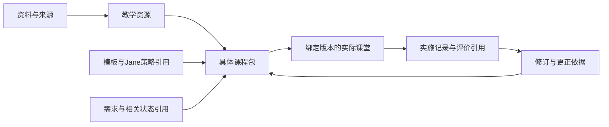

# 课程内容的分层与关系

文档版本：1.0.0；更新：2026年10月12日；范围：逻辑设计，未实现。

内容库将备课成果组织为可追溯、可复用的对象，保证课堂与评价取得实际使用的内容。模块入口见[README.md](README.md)。本文件不规定物理文件布局、API或数据库。

## 五层内容

| 层次 | 保存内容 | 使用边界 |
| --- | --- | --- |
| 原始资料 | 教材片段、读物、参考资料、原件或可获取引用、实际读取范围与日期、来源和未知 | 提供核验依据，链接存在不表示已经读取全文 |
| 教学资源 | 文本、图片、音频、图示、题卡、离屏材料及用途/来源/版本 | 按任务与条件复用，保留实际产物和检查范围 |
| 课程模板 | 观察、新授、复习、探究、项目等可复用框架、必要分支和材料要求 | 提供结构，具体方法引用Jane策略；模板不表示已为孩子备好 |
| 具体课程包 | 主辅目标、阶段/任务/答案、教学分支、资源、简报、需求/状态/Jane绑定、核验与预览 | 针对实际需求准备，依赖和缺口明确，课程是计划不是实施事实 |
| 历史与更正 | 旧版本、派生关系、修改原因、替代/停用范围、更正和使用引用 | 支持回查，不删除或改写真实表现 |

每层都是逻辑职责，不要求独立文件或重复保存原件。资源引用资料，课程引用资源与任务，简报/预览引用同一内容。归档组织和实际存储由platform在后续技术设计中实现。

## 对象标识与共同信息

每个资料、资源、模板和课程具有稳定标识。版本记录内容变化，名称仅用于人阅读，不能因措辞变化重复建同一对象。任务标识在明确课程/模板范围内连接目标、材料、帮助和评价，不凭任务同名认为跨课程等价。

共同信息包括：对象类型与标识、名称/版本、来源与创建/修订日期、用途/学科/能力、依赖对象及实际版本、检查和适用范围、缺口、派生/替代/更正关系。未知值保持未知，生成成功不补成内容正确或可用。

学科、能力和概念标识引用统一目录，与learning目标和状态连接；curriculum不另建一套学生等级或知识掌握体系。正式课程标准/教材映射是带来源的参考，实际采用前核实；不按年级自动判断能力，也不预先建立十年全部课程。

## 依赖与使用关系

课程包的实际依赖包括任务、素材、答案依据、Jane配置/策略、本课教师简报、检查与预览。取得这些依赖的方式必须能定位当时内容；只有可变化的外部地址或“最新”引用不能证明历史可复查。

课程与活动是多次使用关系：一门课程或一个版本可被多堂课引用，一份资源可被多个课程引用。实际活动的日期、结束、原答和帮助归evaluation；本模块保存引用和所用版本，不能另造事实或重复样本。

## 模板、个性化与权威来源

模板描述阶段、分支和条件，不预填孩子能力、成绩、学习历史或固定成功次数。新课由preparation结合需求、相关状态与Jane方法适配，具体产物遵循[课程包合同](../preparation/course-package.md)。

teacher维护唯一Jane的角色与全局策略，模板和课程只引用实际版本及本课展开。learning维护档案/计划/状态，课程引用相关准备依据，不复制完整档案为持续更新的学生画像。evaluation维护真实事实与判断，成人开发数据不能通过课程库导入为儿童学习历史。

索引与选择见[discovery-reuse.md](discovery-reuse.md)，版本见[versions-lifecycle.md](versions-lifecycle.md)，素材与历史见[presentation-resources.md](presentation-resources.md)、[history-corrections.md](history-corrections.md)。本轮只建立设计说明。
