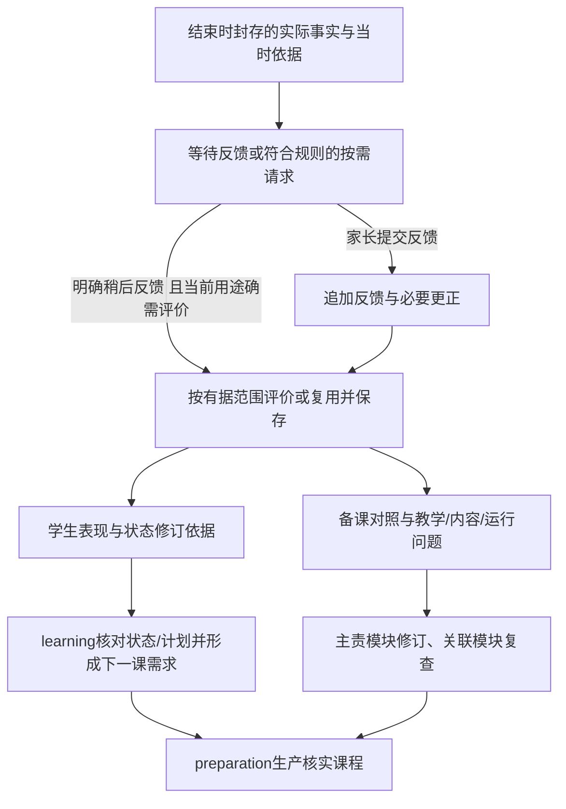

# 评价模块交接与设计检查

文档版本：1.3.1；更新：2026年10月12日；范围：逻辑设计，未实现。

evaluation维护实际事实与本次解释，learning维护跨课状态/计划，teacher维护Jane方法，preparation生产课程。对照与问题共享来源/标识，主责与关联清楚；不要求拆成独立服务、增加Agent或确定数据库/API。

[共同业务合同](../shared/business-contracts.md)区分评价依据与家长汇总报告。按[应用层执行](../shared/execution-recovery.md)先保存事实/评价依据，再由learning落实状态/计划/需求，评价取得实际结果后汇总；改进问题交主责，不让报告和下游互等，部分失败不全链重跑。

跨模块步骤由[应用协调层](../application/README.md)组织；本模块返回自己维护对象的实际结果、影响范围及下一步，操作进度不成为另一份业务对象。

涉及继续条件的“关键”与阻断判定，统一采用[共同阻断标准](../shared/business-contracts.md#关键阻断的共同标准)。

## 模块交接

| 模块 | 输入/输出与边界 |
| --- | --- |
| classroom | 提供结束后的实际事件、输入/帮助/交付/确认、指认离屏、时间和实际绑定；不靠教案补事件，也不将课后评价回放为课堂输入 |
| curriculum | 提供当时版本/依赖、答案/素材/简报、使用限制和更正；取得实际使用及问题引用，内容库不另存第二份课堂事实 |
| learning | 提供相关状态/计划/材料经历，取得任务判断、范围/帮助/未知、状态依据和下节建议；核对适用范围后落实，不再逐题评分 |
| teacher | 提供绑定Jane方法，取得有据行为/版本、指导/纠错/再试结果、体验与改进假设；维护方法，不直接更新学生状态 |
| preparation | 提供课前目标、任务依据、核心/可选、分支/预算和核验；取得对照与内容/难度/材料/支持不适配证据，按learning需求修课 |
| interface | 收集家长原话、补充/更正与必要决定，呈现统一报告/处理状态；不另建评分、学生等级或把建议显示成已落实 |
| platform | 提供实际技术结果、有限范围模型调用、访问和课后保存/版本状态；技术成功不判事实、教学效果或业务完成 |

向learning至少交付活动/记录/评价修订与实际日期/来源类型、实际课程或课外来源、能力范围、原答/作品、帮助/熟悉度/媒介条件、判断/限制及建议。向teacher/preparation的改进问题至少连接实际事件/版本、计划与实际、许可/原因、影响、主责/关联、建议与复查方式。

## 两条调整路径

下节建议经learning结合全学科与家庭条件转成需求，preparation再设计课程；直接内容/运行问题可交对应模块处理，不绕过目标和决策权限。Jane配置版本改变须复核相关课程与就绪，不能热换当堂或旧历史。

## 接收、落实与一致性

交接只带必要摘要/原证据引用与版本，保持事实、判断、建议及执行结果区分。接收方检查当前来源修订、已处理情况和受影响范围，同一来源重发不再计样本/重复执行；来源更正后重审相关结论，不覆盖新出现的真实依据。

记录已保存、学习状态/计划已调整、Jane/内容已修订、检查通过和下一课备好各有实际依据。部分失败或冲突明确未完成项并从同一活动/修订接续，不把模型返回当所有模块已落实。技术一致性实现后续设计。

常规有据更新按已授权范围落实并解释，重大方向/优先级/预算/主要教学或评价变化交家长具体方案；必要澄清不变成逐题审批。旧项目仍是家庭历史权威，成人/技术分类不能因报告形式相同转为儿童证据。

## 未来实现需要验证的场景

| 场景 | 必须得到的结果 |
| --- | --- |
| 正常结束、未确认、停止或中断 | 保存实际范围/原因，未完成不补造，不强迫补测 |
| 没有反馈或明确“无额外补充” | 两者都不阻止结束封存；前者保留待反馈，后者完成该提交，不补独立/顺畅；阶段性评价按[按需规则](../shared/execution-recovery.md#阶段性评价的按需触发)触发或复用，判断限于证据范围 |
| 家长报告与课堂记录冲突 | 保留双方来源，核对任务/条件，关键项澄清，其余未知 |
| 原答含糊或家长代答/帮助不明 | 限制判断，不默认为错误或儿童独立表现 |
| 支架生成未交付、帮助后答对 | 区分计划/实际帮助，保留初答与条件，不自动判独立 |
| 合理变式、开放回答和识别更正 | 按当时依据分维度解释，修订原来源，不制造新发言 |
| 英语表达需支架、概念表现有依据 | 分维度更新依据，不统一升降级或增加活动日期 |
| 转写清晰、听到小结、作品完成 | 不分别冒称发音合格、理解或全部独立掌握 |
| 原题重复与不同日期/新情境样本 | 区分练习、保持/迁移条件，周复盘不新增样本 |
| 备课预期与实际允许支持不同 | 记录合理适配及结果，必要修订预期，不机械扣完成率 |
| 超范围/核心遗漏或材料不适配 | 对照基线、原因和许可，交主责/关联处理，不自动归咎孩子 |
| 明确停止导致覆盖不足 | 如实保存不足和停止规则情况，不直接判失职/不会 |
| 技术等待、声音未交付、实际学习困难 | 原因与影响分别定位，计时缺失不猜，运行修复不改能力 |
| 课后修改教案或只有计划无事件 | 保留原基线，实际缺失，不事后伪装完全契合 |
| 课外作品/外部测评无课程 | 保存真实来源/日期/条件，对照不适用，不造AI课堂 |
| 同一反馈重发、旧作品重传、多模型重评 | 不重复活动/独立样本；真实两次相同回答不误去重 |
| 原答/帮助/日期/答案依据更正 | 保留原记录并回查状态/计划/方法，不只修未来，不重放控制器 |
| 报告生成但保存或下游处理失败 | 明确实际完成范围，恢复原修订，不冒称已更新/备好 |
| 常规巩固与长期/主要方式变化 | 前者按权限落实解释，后者交具体方案家长决定 |
| 成人演练、技术模拟与儿童真实来源 | 分类隔离，前两者不产生儿童状态/材料进度 |

总体要求见[acceptance.md](../../docs/acceptance.md)。

按[基础服务交接](../platform/handoffs.md)取得实际运行配置/模型信息、交付/失败范围和课后保存结果，用于有据解释运行影响；技术结果不补学生原话或自动归因。[存储接续](../platform/storage-lifecycle.md)关联原活动/来源修订及各模块落实，模型拒绝或技术失败不算孩子错误，数据处理条件不明不外发真实儿童来源。
