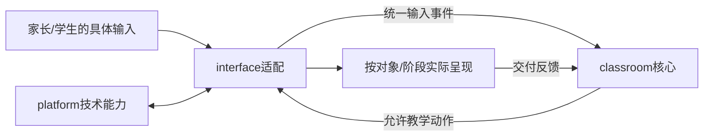

# 界面交接与设计检查

文档版本：1.3.1；更新：2026年10月12日；范围：逻辑设计，未实现。

interface呈现统一业务结果、取得实际操作与反馈，适配不同媒介；业务对象/判断各有权威来源，不在界面另建评分、课堂转场、能力状态、计划或评价。输入提交机制见[input-submission.md](input-submission.md)。

界面发起[应用层用例](../shared/execution-recovery.md)，按[共同合同](../shared/business-contracts.md)显示接收、生成、保存、生效与待处理各自结果，不承担用例业务判断。待反馈/丢失及下一课草案/正式条件明示，旧需求沿用必须有业务适用结果；重发、更正和新尝试保持区别。

跨模块步骤由[应用协调层](../application/README.md)组织；本模块返回自己维护对象的实际结果、影响范围及下一步，操作进度不成为另一份业务对象。

涉及继续条件的“关键”与阻断判定，统一采用[共同阻断标准](../shared/business-contracts.md#关键阻断的共同标准)。

## 模块交接

| 模块 | 向界面提供/从界面取得什么 |
| --- | --- |
| learning | 当前重点/状态/计划、需求与实际调整结果；取得家长条件/调整意图/必要决定，家长不手工评级 |
| preparation | 版本绑定预览、材料/职责、关键缺口与修订；取得实际条件/反馈，预览显示不等阅读/接受/就绪 |
| teacher | 唯一Jane身份、可用表达偏好与方法改进说明；偏好按允许范围处理，不因切学科/媒介换教师 |
| curriculum | 候选/历史/固定内容、对象阶段与使用限制；内容按角色许可取得，不复制教案/版本真相 |
| classroom | 本堂状态、允许教学动作/材料/等待条件、控制结果；取得统一输入/交付反馈与能力变化，不让UI自判转场 |
| evaluation | 任务评价/课堂对照、下节建议、原答/更正与实际下游处理；取得一次家长反馈/必要澄清，维持原来源 |
| platform | 实际识别/合成/媒介/访问/取消、身份/会话/权限和同步能力；技术结果不判教学就绪或能力 |

交接关联对象/实际版本、用途/对象/阶段、真实来源/条件、结果/未知与下一步，仅加载必要内容。页面采用结果时核对当前对象，不把迟到课程/报告套入另一个活动；模型/界面文本不修改项目规则。

## 与课堂核心的单轮交接

输入事件、教学动作和交付反馈按[适配设计](input-output-adapters.md)及[课堂合同](../classroom/boundaries-events.md)连接实际身份/状态/版本。界面不以按钮点击、音频完成或页面进入判任务完成；实际收到确认来自输入，理解由表现解释。

## 角色、条件与一致性

按[角色/设备设计](roles-devices.md)提供材料访问、当前学习输入与选定语音输出，权限由业务/平台共同执行。来源不清保留未知，页面角色不直接证明作答者；重要决定来自实际授权，常规操作不增加审批。

课堂状态、具体媒介/同步与保存/更新结果分别显示。暂停/停止本端即时取消并通知核心，断网说明同步未确认，恢复先核对控制；同一事件重发/反馈重试不重复样本，真实相同回答不按文本去重。

反馈/报告按原活动与修订接续。按[共同规则](../shared/execution-recovery.md)先显示事实封存回执，后收反馈；待反馈、保存失败/未知和已保存分别显示，只有未存部分受进程丢失影响。

## 未来实现需要验证的场景

| 场景 | 必须得到的结果 |
| --- | --- |
| 首页课程为候选/草案/已备好 | 状态范围与下一步明确，不自动标当前可开课 |
| 预览显示、家长阅读与重要决定 | 分别保留，已明确条件不重复询问，新版提示受影响变化 |
| 材料/声音不具备或只配置入口 | 显示缺口，不手改就绪；按实际能力与核实备用检查 |
| 孩子自然回答、求助和确认 | 自动提交/接续核心，家长不逐句转交，不要求固定口令 |
| 识别片段/含糊/更正或教师声音回声 | 不当完整儿童答案，保留原来源，不静默评分新任务 |
| 字幕、全文、重播、语速或图片提示 | 服从任务许可，变化通知核心，不冒称原独立条件 |
| 未启用支架、教师答案与家长教案 | 学生端不提前取得，不只靠隐藏显示；帮助后按许可呈现 |
| 输入未送达/处理中/回应被打断 | 提示实际状态与路径，反馈真实范围，不自行转场或确认收到 |
| 指认、离屏返回但没报结果 | 来源清楚，返回不代填完成，离屏停止收音/连续互动 |
| 家长接手、切回学生页 | 暂停/取消、来源与材料权限明确，原会话接续不重交旧答案 |
| 新设备加入或移交 | 核对能力/状态，当前学习输入和语音输出明确，避免重复采集/播放 |
| 操作界面角色与实际提供者不同 | 记录实际报告/代述或未知，不默认孩子独立 |
| 播放/判断中停止，断网停止 | 本端立即取消，核心同步如实标注，恢复不自动播放迟到结果 |
| 刷新、离页、连接恢复或进程丢失 | 不隐藏收音/重开课堂，按原会话恢复或明确中断缺口 |
| 同一点击/反馈重发，两次真实同句答案 | 前者不重复处理，后者保持实际尝试，不按文本去重 |
| 无反馈、明确无补充或只提交部分观察 | 入口状态与未知清楚，不自动填完整学习结果 |
| 报告已生成但保存/下游更新失败 | 分别显示实际完成/待处理，恢复原活动，不冒称已备好 |
| 家长更正事实/必要决定 | 关联原修订，业务处理后显示实际影响，显示/朗读不代替授权 |
| 成人演练/技术与儿童视图 | 活动类型不因角色标签改变，前两者不进儿童证据 |

后续真实媒介、成人完整流程、30分钟与儿童效果分别验收，见[acceptance.md](../../docs/acceptance.md)。

基础技术交接按[平台设计](../platform/handoffs.md)连接用途、实际版本/参数、能力/权限、期限/取消及处理范围。界面显示本地交付、同步、保存和业务更新各自真实状态；服务商技术会话不作教学权威，儿童数据缺口按[条件设计](../platform/configuration-permissions.md)明示，不靠界面标记绕过。
