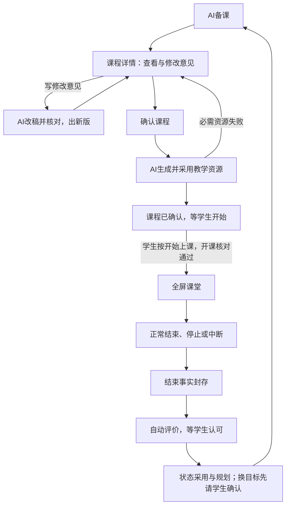

# 课程详情、修改与开始

文档版本：2.5.0；更新：2026年11月20日（扩展阅读，[ADR-0033](../../decisions/ADR-0033.md)）；范围：逻辑设计，按[ADR-0018](../../decisions/ADR-0018.md)实施中。

课程详情内容由preparation从实际课程/核验生成，interface负责呈现与学生的修改意见、确认操作，classroom/platform核对本次开课。三者各有来源，不由界面勾选覆盖就绪依据。

涉及继续条件的“关键”与阻断判定，统一采用[共同阻断标准](../shared/business-contracts.md#关键阻断的共同标准)。

## 完整使用流程

图表示导航与交接，教学阶段与转场仍由核心决定。备课中、等你确认、待上课、已上、已评价分别显示；未就绪原因给出下一步，不因页面出现就记录已读、接受或开课。

## 课程详情

说明为什么上、主辅目标、故事、题目、预计帮助、时间与退出、需要的实物、教学资源清单与讨论记录。学生写修改意见后由AI改稿，规则核对通过才成为新版本，旧版本记录保留；修改不在页面上直接编辑题目文字。常规小调整直接落实；需要换目标或改变计划的意见，在说明里写明要回到学习规划。

教学资源在确认后由AI生成并采用每项最新一次成功的版本（[ADR-0017](../../decisions/ADR-0017.md)经[ADR-0018](../../decisions/ADR-0018.md)修订）。学生可以试听、查看、重新生成或选回旧版本；课堂只用采用的版本。资源区最后是“Confirm resources”：确认后在用的版本放进课程文件夹、其他版本删除，资源区改为只列在用的那一版（可试听或查看）并显示课程文件夹名，不再有Make again与版本切换，另有“Remake broken resources”只重做文件已失效的项；未确认资源时点Start，按当前版本代为确认后开课（[ADR-0027](../../decisions/ADR-0027.md)）。课文插图与带图题的图（[ADR-0026](../../decisions/ADR-0026.md)）要经备课模型看图核对后才采用：学生重新生成这类图后自动连同同题的其他图再核对一次，通过即采用；选回旧版本也先核对，不通过就保留在用的图并说明原因。资源清单对核对最终不合格的写“In words instead”（带图题改用文字）或“Not shown”（插图不显示）及原因，对没能核对就采用的插图写“not checked”。

## 确认与开始

确认和开始分开（2026年10月21日用户决定：确认后直接开课不合理）。“确认课程”保存对这一确切课程版本的确认，AI随即在后台生成并采用资源（页面显示第几项），不会开课；之后主页的下一步是“课程已确认，准备好就开始上课”，学生在课程详情按“开始上课”时才做本次开课核对并进入课堂。开始时若还有资源没采用（如生成失败或服务重启），先补齐再开课。确认后不再写修改意见。核对采用课程与固定依赖、检查范围/更正限制、评分与合成是否就绪；课程用到实物时须学生勾选“实物已备好”，时间按课程预算核对，不再询问陪伴。各依据维护者、冲突处理及进入条件按[开课判定表](../classroom/session-start.md)，界面不自行覆盖。

重上这节课（2026年10月21日用户要求，因上一课开课后很快被停止）：上一课由学生停止或服务中断而结束、它的评价还没认可、需求没有重新规划时，同一课程版本可以再开一次；应用协调层据此在“评价等你认可”里给出这门课，课程详情显示“重上这节课”。重上是新的一次课堂活动，照常做开课核对，已采用的资源直接沿用；停止的那次事实与评价原样保留在历史里，可以不认可，也可以之后认可作为记录，学习状态与下一课只按最新一次推进。开课日志记第几次上这门课（attempt）。

必需资源失败时不开课，停在课程详情并给出原因与重试；可选资源失败不阻止开课（语音改现场合成，图片、动画不显示）。已有暂停会话时沿用原会话，不把刷新或重复点击当作一堂新课。

建档小测仍一次完成确认、资源与开课，按钮为“开始小测”：学生点它本身就是开始。

## 扩展阅读

已上或已评价的课（含建档小测）在课程详情多一块“Expand this story”（[ADR-0033](../../decisions/ADR-0033.md)，设计见docs/superpowers/specs/2026-11-20-extended-reading-design.md）：选四档难度之一（Same as my level、A little harder、Challenge、Harder，各写目标蓝思值，默认第一档、不写回学习资料），按“Expand”后AI在后台把这篇课文扩写成一本分章英文小说（2000–4000词、4–6章，生词盒全部生词各用一次以上，原课静态插图放进对应章节、每章另画一张新插图）。本课的书逐本列出：写作中显示“Planning”“Writing chapter n of m”“Drawing pictures”与进度条，失败写明原因并可“Retry”（从没写完的一步接着做），完成的书显示书名、目标值、词数与章数，可“Download EPUB”（带令牌取回后保存，传到手机用阅读器读），展开章节后每章可“Revise”：写修改意见，只改写这一章并重新打包，修改意见只用于这次请求、不保存。没上过的课不能扩写（先读长篇会提前知道题目答案）。课堂进行中、有扩写或改写在运行、或参考题集在运行时不能扩写、重试或改写；扩写进行中开课时先取消扩写再开课，记失败“stopped because a class started”。扩写书不进入评价、学习状态与生词掌握，原课程文件夹不改。

## 范围与缺口

本次条件改变只复核受影响范围，课堂不自动换最新课程/Jane。开始后界面只执行允许动作，参见[交接](handoffs.md)。
