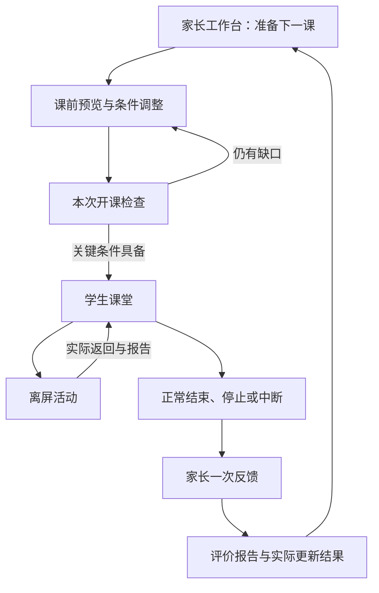

# 课前预览、条件调整与启动

文档版本：1.0.0；更新：2026年10月12日；范围：逻辑设计，未实现。

预览内容由preparation从实际课程/核验生成，interface负责理解、操作与实际家庭反馈，classroom/platform核对本次启动。三者各有来源，不由界面勾选覆盖就绪依据。

## 完整使用流程

图表示导航与交接，教学阶段/转场仍由核心决定。候选、草案、预览可读、备课完成与本次可开课分别显示，未就绪原因给出下一步；不因页面出现就记录已读、接受或开课。

## 一页预览

默认说明为什么上、主辅目标、基本预期/可能帮助、活动/时间概览、必需/可选材料、家长职责、挑战/退回/退出以及当前缺口。完整教案与检查依据可按角色展开，不成为必读或逐题审批清单；预期不保证掌握。

预览连接实际需求/课程/检查版本。家长可报告“今天时间更短”“某材料不可得”等条件，提交后由业务模块判断影响/替代并回报新版预览与差异。常规适配按已授权范围完成，重大变化提供具体方案决定；原反馈保留来源，不反复询问已明确的信息。

新版影响已阅读范围或关键决定时只提示变化与必要处理，不自动继承对新内容的接受，也不要求重读无影响部分。课前学生可见内容按任务规定，不能通过家长预览或附件提前取得教师答案/支架。

## 本次开课检查

家长开始请求可合并对安排的采用与必要条件报告。核对采用课程与固定依赖、检查范围/更正限制、数字访问、实物、输入/呈现/取消能力及家庭时间/陪伴；只补关键未知，不每堂重复全部成人演练。

interface取得必要家庭实际确认和当前能力，platform执行实际设备/媒介/访问检查，classroom核对任务条件并决定是否可进入。配置、按钮存在、预览或人工就绪标记不证明声音/流程通过。不同媒介和备用是否适合任务按业务规则判断，见[readiness.md](../preparation/readiness.md)。

成功后绑定实际版本的独立会话进入学生视图，目标/任务接续由核心控制。已有暂停会话请求继续时沿用原会话，不把刷新、重复点击或另一设备加入当一堂新课。目标对象不清且有多个候选时只补必要选择，不猜采用课程。

## 范围与缺口

关键内容/能力未具备时显示具体缺口及准备、检查或修订入口，不能改称家长课绕过验收。正式儿童入口仍须相应验收与家长明确开始，0.1原型目前不可用，本轮不开放或运行它。

本次条件改变只复核受影响范围，课堂不自动换最新课程/Jane。家长报告与技术反馈各自保留，教学结果不由开课成功推定；开始后界面只执行允许动作，参见[交接](handoffs.md)。
