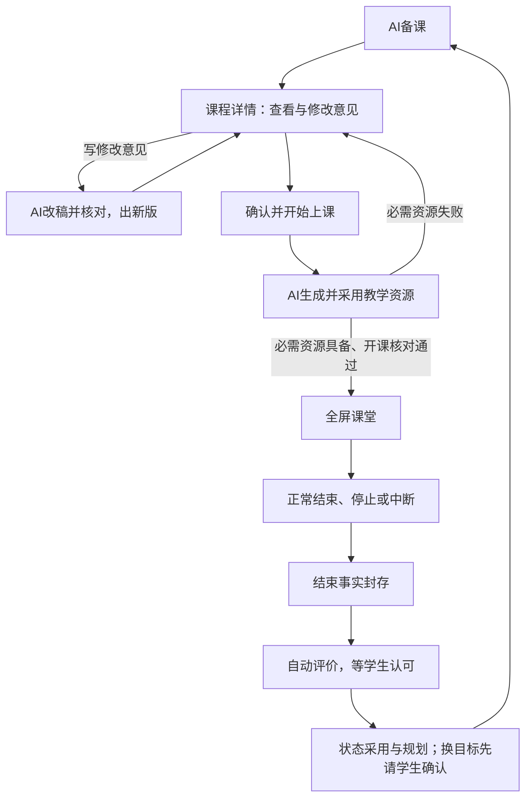

# 课程详情、修改与开始

文档版本：2.0.0；更新：2026年10月20日；范围：逻辑设计，按[ADR-0018](../../decisions/ADR-0018.md)实施中。

课程详情内容由preparation从实际课程/核验生成，interface负责呈现与学生的修改意见、确认操作，classroom/platform核对本次开课。三者各有来源，不由界面勾选覆盖就绪依据。

涉及继续条件的“关键”与阻断判定，统一采用[共同阻断标准](../shared/business-contracts.md#关键阻断的共同标准)。

## 完整使用流程

图表示导航与交接，教学阶段与转场仍由核心决定。备课中、等你确认、准备中、已上、已评价分别显示；未就绪原因给出下一步，不因页面出现就记录已读、接受或开课。

## 课程详情

说明为什么上、主辅目标、故事、题目、预计帮助、时间与退出、需要的实物、教学资源清单与讨论记录。学生写修改意见后由AI改稿，规则核对通过才成为新版本，旧版本保留；修改不在页面上直接编辑题目文字。常规小调整直接落实；需要换目标或改变计划的意见，在说明里写明要回到学习规划。

教学资源在确认后由AI生成并采用每项最新一次成功的版本（[ADR-0017](../../decisions/ADR-0017.md)经[ADR-0018](../../decisions/ADR-0018.md)修订）。学生可以试听、查看、重新生成或选回旧版本；课堂只用采用的版本。

## 确认并开始

一次点击包含：确认这一确切课程版本 → 生成并采用资源（页面显示进度）→ 本次开课核对 → 进入课堂。核对采用课程与固定依赖、检查范围/更正限制、评分与合成是否就绪；课程用到实物时须学生勾选“实物已备好”，时间按课程预算核对，不再询问陪伴。各依据维护者、冲突处理及进入条件按[开课判定表](../classroom/session-start.md)，界面不自行覆盖。

必需资源失败时不开课，停在课程详情并给出原因与重试；可选资源失败不阻止开课（语音改现场合成，图片、动画不显示）。已有暂停会话时沿用原会话，不把刷新或重复点击当作一堂新课。

建档小测走同一路径，只是没有修改意见一步，按钮为“开始小测”。

## 范围与缺口

本次条件改变只复核受影响范围，课堂不自动换最新课程/Jane。开始后界面只执行允许动作，参见[交接](handoffs.md)。
