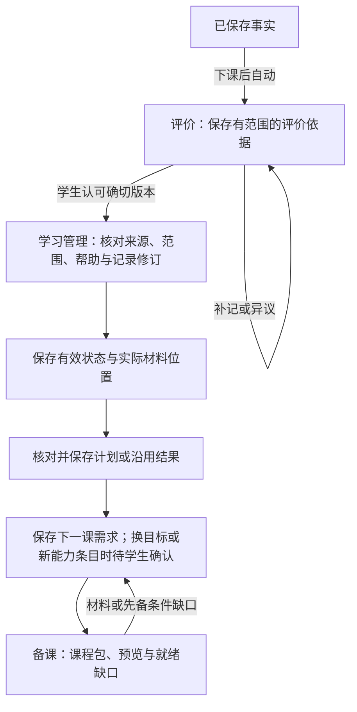

# 课后更新与计划调整

版本：2.1.0；更新：2026年11月2日；范围：逻辑设计；按[ADR-0018](../../decisions/ADR-0018.md)实施中。

学习管理依据学生已认可的评价更新状态与计划；评价在下课封存后自动进行，学生可补记或提出异议后再认可，认可后要改走更正。按[ADR-0030](../../decisions/ADR-0030.md)，初答正确且课中无帮助即单次独立，未补记外部帮助不阻止独立，也不阻塞所有有据更新。课中只维护本堂必要内存与教学判断，不监控、不写快照、不阶段归档或更新正式长期状态。

涉及继续条件的“关键”与阻断判定，统一采用[共同阻断标准](../shared/business-contracts.md#关键阻断的共同标准)。

## 更新流程

| 步骤 | 处理与输出 |
| --- | --- |
| 1. 确认来源与活动结束 | 区分正式学习、技术模拟；本堂标识与实际日期清楚，未收到声音和动作不能补造 |
| 2. 整理事实与判断 | evaluation保留原答/原话、实际帮助和完成报告；学生补记、实际观察、AI解释及假设分开 |
| 3. 检查更新依据 | learning复用任务判断，核对证据与适用范围、帮助条件、旧状态及重复来源，不重新逐题评分 |
| 4. 更新状态与材料位置 | 只更新有证据的维度，保留首次和帮助后差异、原判断与新修订；未观察保留未知 |
| 5. 调整计划 | 通常只影响下节或本周；反复出现或阶段复盘支持时再调整阶段/年度计划，重大方向变化请学生决定 |
| 6. 返回学生结果 | 课堂评价、状态/计划主要变化及依据、下节预期、关键未确定项；细节与证据可展开 |

“活动结束、记录收尾”不表示所有题完成、正常小结已听到或能力掌握。提前停止仍可整理真实活动，保留未完成项，不补造离屏与总结。

评价输入与判断按[评价模块](../evaluation/README.md)，状态依据来自实际任务/帮助/条件；[课堂对照](../evaluation/lesson-alignment.md)的超出不足不是自动能力升降级指令。明确停止、运行故障和允许适配分别处理；保存/更新/计划结果按[报告修订](../evaluation/reports-revisions.md)返回实际状态，来源更正后只重审受影响范围，不覆盖新出现的真实依据。

处理顺序及失败采用[共同执行](../shared/execution-recovery.md)。本模块取得已保存的可用评价后，核对状态、计划和候选建议，返回实际修订或沿用结果；复盘调整按[专门用例](plan-review.md)，不在本文件维护另一套跨模块流程。

## 可更新的信息

- 能力工作判断：任务级实际样本可更新单次判断；不同日期、相近范围的独立样本才支持多次描述，保持与迁移另有相应样本。
- 家庭材料位置：记录实际接触、练习和应用，不把备课或计划位置当完成。
- 体验与投入：保留学生原话、当次情况与学习负担，服务活动调整，不推断人格或诊断。
- 档案事实：来自新的实际报告或更正；年龄等背景按日期计算，不反向由表现猜出生日期、性别或学籍。
- 近期需求：根据上述信息安排巩固、复查、拓展或小步进阶，写明依据与待验证条件。按[ADR-0030](../../decisions/ADR-0030.md)，规则先按本课主要目标的计分题算出方向：全部单次独立为升（只能进阶或拓展，只加一种主要难度），平均低于6分为降（不能进阶或拓展，只退回上一步），两者同时成立以降为准，有题得分未知或其余情况由规划判断；方向不合规则时需求不保存、可重试。需求只写练什么与这一步难度，不写题目清单。

学校作业、人类教师观察、外部测评等课外来源也可提供依据：保留其真实日期、任务、说话者与帮助条件，不为了导入而虚构AI课堂。外部测评仍归参考；若实际作品条件清楚，可形成对应范围的任务证据。

## 去重、更正与一致性

- 同一堂课的事件、学生补记、作品和后续补充合并到同一活动，引用同一来源修订，不计为多个活动日期。
- 对已经结束的活动只整理或更正记录，不把转写回放重新送入课堂控制器制造新表现。
- 保存原事实及更正说明；更正原答、帮助或活动日期后，重新审视依赖它的状态和未来计划。不能只改摘要而留下旧结论。
- 较难新任务的困难不覆盖较简单任务中的有效状态；新旧表现不同应缩小适用范围或标注不一致，不强迫学生回答“到底会不会”。
- 旧证据不适用或间隔很久时安排轻量复查，不自动降低等级；新的上传日期不是新的学习日期。
- 同一证据可关联多个学科，但每个判断要有实际依据。多维度引用不增加样本次数，也不默认每个维度都独立。
- 更新未保存、部分失败或发生版本冲突时，明确尚未完成的部分，保留依据并从同一活动/修订接续；不能重复计样本或显示不存在的完成。具体存储与恢复实现后续设计。

## 未知与关键澄清

只追问影响当前判断或下一步的关键信息，如内容帮助是否发生、材料是否背过、活动日期冲突。先完成有依据的部分，其余保持未知。缺少完整逐字稿或某个无关字段不要求全部补齐。

语音识别错误、未报告离屏、泛泛“都会了”等不足以支持具体独立状态。可安排下次短观察；识别分数不用于评价发音。兴趣、健康状态等替代解释只在有来源时记录为可能影响条件，不编造原因。

## 决策权限与学生可见结果

AI可直接落实已授权范围内的状态维护、复习安排、材料替换、帮助方式和近期小调整，并解释依据。学生不用逐项批准状态，也不用先给能力等级。

下一课需求的主目标或辅助目标与上一课不同、或需要目录外的新能力条目时，需求先保存为待确认，附理由与新条目定义；学生确认后才建立新条目并开始备课。学生不同意时，规划带“沿用原目标”的要求重做一次。建档后的第一个目标总要学生确认。

学科优先级、长期方向、固定预算、主要评价方式或主要教学方式的变化，应形成具体方案、证据、影响与复查时间，交学生决定并保留决策。当前的临时缩短、学生要求停止不需要等待计划审批。

一次更新让学生看到“原判断或安排 → 新判断或安排 → 为什么 → 还有什么不确定 → 下节预期”。计划改动应尽量局部，不因单次波动重新规划十年，也不把重复相关表现宣称为AI教学的因果效果。

交接版本与责任见[handoffs.md](handoffs.md)。
