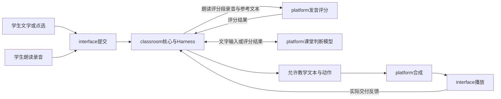

# 实时语音与受控交付

文档版本：2.0.0；更新：2026年10月16日；范围：逻辑设计，实际声音未验证。

语音在课堂中有两种用途：Jane的声音交付，以及英语朗读/跟读任务的录音评分。其他作答、求助与确认用文字、点选等明确提交，不录音，模型不听录音，也不设语音识别。interface管理具体设备、朗读录音和播放，platform经适配器提供发音评分、合成、传输与技术状态，classroom决定回应内容、帮助和转场。采用依据见[ADR-0014](../../decisions/ADR-0014.md)。

## 首版交互路径

普通任务按[提交合同](../interface/input-submission.md)提交文字或点选，核心把输入与必要上下文交课堂判断模型。朗读评分任务由孩子按麦克风录音、按结束提交，核心把录音与参考文本交发音评分，再把评分结果（不含录音）交课堂判断模型。模型返回判断与回应文字，核心批准后交合成与播放。模型只提出判断与动作，停止、转场与等待对象仍由核心控制。

以后如接入语音对语音等更直接的方案，必须证明输入持续进核心、教学回应先取得许可、实际内容及交付可核对、取消有效，才能作为替代；不能仅凭角色提示或工具被调用声称满足。实际延迟按[质量门槛](../../docs/acceptance.md#最小版本质量门槛)核对。

## 英语朗读录音与发音评分

朗读录音只用于课程包标为需要发音评分的英语朗读/跟读评分段。孩子按麦克风开始录音，可暂停/继续（仍为同一段），按结束提交，可重录；录音中和暂停中的内容只在本端，不进核心。Jane播放时按麦克风先停本端播放再录音。

发音评分由独立的发音评分适配器提供：输入为本段录音与课程包给定的参考文本，输出逐词/音素的准确度、流利度、完整度、服务给出的等级（如有）及服务与版本。课堂判断模型据评分判断本段是否达到任务要求、哪些词要纠正、是否需要示范或重读，并把评分转成适合孩子的纠正话术，提出继续、重读或换段等动作；是否推进由Harness按允许动作决定。模型不另评发音，也不改写评分。

评分是证据，不是成绩：进入课后评价的英语发音子项，与听、读、写分开，评价模型据各段评分分析发音情况与下次练习重点；不同服务或版本的分数不直接比较；录音过短、嘈杂、未读或评分失败记未知，不记低分。长篇朗读按[课程包](../preparation/course-package.md#朗读评分段与预合成语音)在备课时切成评分段，每段不超过所选服务上限，课堂逐段录音与评分。

儿童录音只发给所选发音评分服务，按[儿童数据边界](configuration-permissions.md#儿童数据处理条件)由家长按该适配器条款知情采用。

## 播放与打断

合成由独立合成适配器提供，只合成核心已批准的文本，Jane声音配置固定。课程包中固定的教师语句与示范音在备课时预合成并核验，课堂直接播放；现场回应在批准后流式合成。不用多模态模型直接出声：文字与声音同时生成时无法先经核心批准，也不能保证读出的即批准内容。

每次合成/播放连接实际动作、文本/素材版本、对象、阶段和状态。可对已经批准的完整语义单元流式交付；未经核心许可的模型片段不能先播后检查。字幕、重播、语速及文字替代服从任务条件，技术成功不使评价条件等价。

分别报告生成完成、可交付、开始播放、部分/完整播放、失败、取消和打断。学生实际收到确认来自输入，理解依据实际表现，不从播放结束推定。实际已播放范围不明时保留未知，不自动对齐成精确逐字记录。

孩子提交新输入或按麦克风时先停止当前本端声音并使待播内容失效，核心根据新输入决定接续；普通插话不自动等于整课停止。明确暂停/停止走优先控制，不等待教学模型或评分，取消可控录音、播放和等待并通知核心。远端计算无法取消时丢弃迟到结果。

## 离屏、恢复与等待

进入离屏、暂停、家长接手或离开运行视图后停止录音及连续互动；返回原课堂时先核对状态，再取得实际报告，不能因返回页面代填离屏完成。恢复不自动重播取消的语音。

报告提交、评分结束、判断结束、合成与实际首播时间，后台完成时间不冒称听觉延迟。普通短答起点为提交时刻（朗读为孩子按结束或最长时长到期），十秒期限和目标阈值按[质量门槛及P0样本](../../docs/acceptance.md#p0固定短测样本与测量记录)；朗读段最长录音时长不超过所选评分服务上限，超时有限处理，不空等家长催促。

默认只保留本段录音于内存，交给发音评分后即弃，不归档儿童原始录音或隐藏磁盘缓存。断网停止与恢复见[sessions-sync.md](sessions-sync.md)，必要内容课后保存见[storage-lifecycle.md](storage-lifecycle.md)。
