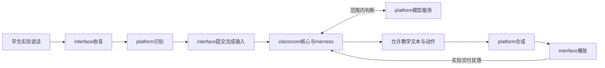

# 实时语音与受控交付

文档版本：1.1.0；更新：2026年10月12日；范围：逻辑设计，未实现。

实时语音为同一课堂核心提供自然输入与声音交付。interface管理具体设备、收音和播放，platform提供识别、合成、传输与技术状态，classroom决定回应内容、帮助和转场。

## 首版交互路径

清楚且完成的回答、求助和确认自动进入核心，无需家长逐句说“交后台”。连续收听和按轮核心判断可以组合；连续输入不意味着语音模型拥有独立教学流程。完成输入按[提交合同](../interface/input-submission.md)由interface适配器组织；platform提供技术信号，协议及参数通过实测选择并绑定。

OpenAI Realtime支持保留语音活动检测并关闭自动回应，由应用触发回复。J据此设置程序控制入口；关闭自动回应本身不保证输出逐字符合批准文本，首版以合成已允许内容控制发声。[官方对话控制](https://developers.openai.com/api/docs/guides/realtime-conversations)

以后如接入更直接的语音方案，必须证明输入持续进核心、教学回应先取得许可、实际内容及交付可核对、取消有效，才能作为替代；不能仅凭角色提示或工具被调用声称满足。

## 输入完成与识别限制

识别中片段仅作临时内容，最终识别和提交分别回报；阅读中的短停顿、背景声和教师回声不自动当作儿童完整答案。保留识别文本与原发言来源的区别，未知提供者不补为孩子独立作答，不新增声纹身份库。

含糊时按核心需要澄清，允许更正并连接原事件。更正不是另一次独立尝试；若核心已推进，核对受影响任务，不将旧发言静默评分到下一题。语音活动检测只提供收音边界，不能证明答完、正确或听懂。

转写不用于发音评分。以后发音任务须另行定义音频分析能力、实际条件与依据，并满足[儿童数据边界](configuration-permissions.md)，不因识别清晰判发音合格。

## 播放与打断

每次合成/播放连接实际动作、文本/素材版本、对象、阶段和状态。可对已经批准的完整语义单元流式交付；未经核心许可的模型片段不能先播后检查。字幕、重播、语速及文字替代服从任务条件，技术成功不使评价条件等价。

分别报告生成完成、可交付、开始播放、部分/完整播放、失败、取消和打断。学生实际收到确认来自输入，理解依据实际表现，不从播放结束推定。实际已播放范围不明时保留未知，不自动对齐成精确逐字记录。

打断先停止当前本端声音并使待播内容失效，核心根据新输入决定接续；普通打断不自动等于整课停止。明确暂停/停止走优先控制，不等待教学模型，取消可控采集、播放和等待并通知核心。远端计算无法取消时丢弃迟到结果。

若使用服务商会话，应使其中的未播放内容与实际交付保持一致，不能让后续模型误以为全部说完。官方Realtime对WebRTC/SIP和WebSocket给出不同打断/截断职责，接入必须验证相应能力，不假定协议行为相同。[官方打断与截断](https://developers.openai.com/api/docs/guides/realtime-conversations)

## 离屏、恢复与等待

进入离屏、暂停、家长接手或离开运行视图后停止收音及连续互动；返回原课堂时先核对状态，再取得实际报告，不能因返回页面代填离屏完成。恢复不自动重播取消的语音。

报告输入完成、识别结束、判断结束、合成与实际首播时间，后台完成时间不冒称听觉延迟。等待期限与核实备用由课程和运行配置声明，实际阈值后续测定；超时有限处理，不空等家长催促。

默认只保留本堂必要音频缓冲和事件于内存，不归档儿童原始录音或隐藏磁盘缓存。断网停止与恢复见[sessions-sync.md](sessions-sync.md)，必要内容课后保存见[storage-lifecycle.md](storage-lifecycle.md)。
