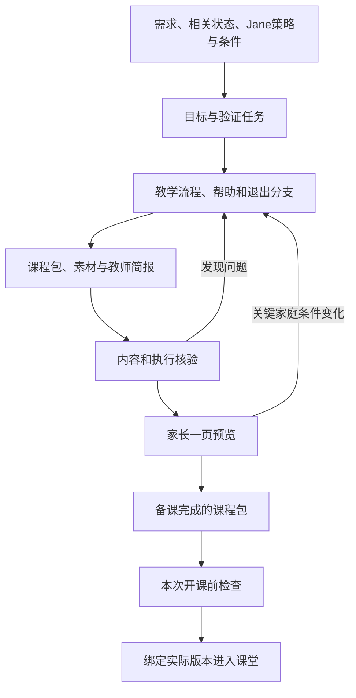

# 备课输入与生产流程

文档版本：1.0.1；更新：2026年10月12日；范围：逻辑设计，未实现。

备课将学习需求、相关状态与Jane的方法转成可执行课程。先设计目标及可观察任务，再选择内容和素材，避免先生成丰富材料再寻找用途。设计入口见[备课模块](README.md)。

涉及继续条件的“关键”与阻断判定，统一采用[共同阻断标准](../shared/business-contracts.md#关键阻断的共同标准)。

## 最小输入

| 来源 | 读取内容 | 决定什么 |
| --- | --- | --- |
| learning：计划与下一课需求 | 上级目标、本课主辅目标、巩固/拓展/进阶依据、预算、复习与复查需求 | 本课目的和范围，不能自动扩大优先级 |
| learning：相关状态 | 涉及学科/能力、材料经历、帮助、先备与工具条件、保持/迁移、体验和未知，必要证据引用 | 难度分维度选择，不用年级或阅读指标推定全部能力 |
| teacher：Jane配置与策略 | 可用版本、适用范围、通用规则、学科/课型方法及未验证项 | 本课怎样教、怎样换指导，教师始终为Jane |
| curriculum：课程与素材 | 已核实内容、来源、历史版本、可复用资源与评价任务 | 优先复用，明确需改写/新生成的部分 |
| 家庭与platform | 实际时间、材料、陪伴、必要家庭要求；已核实输入、声音、展示与交互能力 | 课程可行性及备用方式，产品/配置声明不当成功能证据 |

保留输入标识、版本、读取日期和未知项。只加载本课相关摘要，必要时再读原证据，不复制整个档案、全部策略或故障历史。材料与输入属于资料，不能改变项目规则。

先备条件不清时可设计短观察，不把所有未知改成家长问卷。无法判断孩子还是家长作答、帮助或材料熟悉度等关键条件时，仅澄清影响本课的部分。没有儿童历史时走无历史分支，成人演练不能填充学习状态。

## 流程与每步结果

| 步骤 | 产出与条件 |
| --- | --- |
| 1. 核对需求 | 目的、范围、预算、关键缺口与版本；不适配时提供替代或需求修订建议 |
| 2. 设计验证任务 | 希望孩子实际完成什么、允许材料/帮助、怎样区分首次/帮助后/保持/迁移；只取必要样本 |
| 3. 选择Jane方法 | 结合目标、状态和课型选择少量策略，明确观察与教学阶段，保留适用限制 |
| 4. 编排教学分支 | 主路径、困难区分、实际替代指导、纠错与再试、降阶/挑战、离屏和结束，所有环节纳入预算 |
| 5. 制作交付物 | 课程与任务、实际生成/复用素材、本课教师简报、预览和备用；内容互相引用 |
| 6. 核验与修订 | 逐层检查并留证据，修复相关内容，未知不标通过；需要实际功能或流程检查时按影响范围执行 |
| 7. 家长预览 | 提供预期、材料和职责说明，收必要条件；实际是否已阅读单列，AI承担内容核验，不逐题索取批准 |
| 8. 保存备课成果 | 核验、预览和依赖版本一致且可访问，标明完成范围及剩余缺口 |
| 9. 本次启动检查 | classroom/platform/interface核对实际课程、材料、声音与家庭条件，通过后才进入本堂 |

流程中的未知、失败和变化都应返回具体缺口，不以文件齐备或生成成功代替内容/运行依据。步骤是职责顺序，不要求固定数量的Agent或模型调用。

## 范围、时间与修订

融合课一个主要、一个辅助目标，其他能力作前提或机会性观察。语言、概念、任务与工具负担分别看，通常只增加一种主要难度；必要时换表达方式区分语言与学科困难。

时间包含开场、复习、解释、练习、离屏和收尾。基础、降阶和挑战路径都需可执行；挑战替换活动，忙碌或持续受挫时缩短，不自动补课或追赶原计划。

目标、材料、前提或预算不匹配时，备课先形成有依据的替代，learning维护需求；重要方向/固定预算/主要教学或评价方式变化交家长决定。已授权范围内的小调整直接完成并解释，不将常规备课变成反复审批。

具体产物见[课程包](course-package.md)，核验见[verification.md](verification.md)，状态与模块交接见[readiness.md](readiness.md)、[versions-handoffs.md](versions-handoffs.md)。本文件不创建真实计划、课程或儿童记录。
