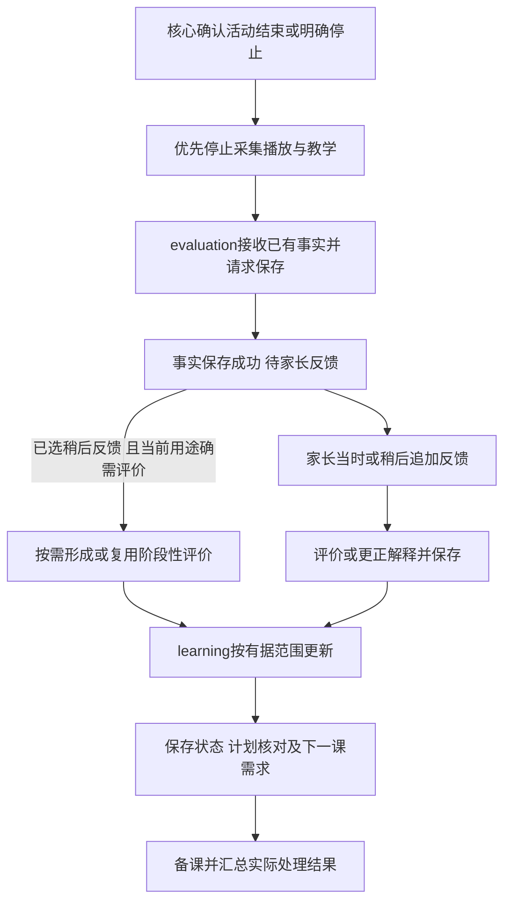

# 跨模块执行顺序与失败接续

文档版本：1.1.1；更新：2026年10月12日；范围：逻辑执行设计，未实现。

应用层协调一次请求从受理到结果、必要等待及失败接续。八个模块各自维护业务判断，协调职责只安排顺序、输入版本、结果和下一步，不评分、不维护第二份档案、不要求独立服务或新Agent。

## 用例协调与共同结果

[应用协调层](../application/README.md)维护操作身份/来源修订和步骤结果，组织准备、启动、结束封存、反馈、复盘、更正及待决定处理。interface发起或接收实际结果；业务模块维护对象与适用性，platform提供保存回执。逐轮教学直接接classroom。

受理、生成、保存成功/失败/未知、业务生效及下一步分别返回。已成功的同操作/来源修订不重做；结果未知先查原操作。进入课堂后协调和运行事件只留必要内存，结束后允许事实与操作进度保存；暂停、离屏和断线本身不作为偷偷归档的结束。

## 准备与启动顺序

| 步骤 | 主责及结果 | 继续条件 |
| --- | --- | --- |
| 1. 形成需求 | learning读取当前有效档案/状态/计划，生成或复核需求 | 正式采用的需求已保存；待处理信息与允许范围明示 |
| 2. 编制课程 | preparation选相关Jane方法和内容，生成任务/素材/简报 | 只采用实际版本与必要资料，不静默改主目标 |
| 3. 固定并核验 | curriculum保存实际内容/依赖，preparation核验并修订 | 关键内容/素材/执行依据及保存完整；失败保持缺口 |
| 4. 家长预览 | interface呈现同版本安排，业务接收实际条件/必要决定 | 预览、阅读、决定分开；有影响变化回到需求/备课复核 |
| 5. 本次检查 | 应用层汇集业务/技术/家长来源，classroom按[判定表](../classroom/session-start.md)返回结论 | 必需项具备且无未解冲突，资格范围适用，家长明确开始；替代路径单独核对 |
| 6. 本堂执行 | classroom绑定版本，interface交付，platform提供能力 | 只核心推进，实际输入/帮助/交付在内存，停止优先 |

已备好内容不自动变成本次可开课。开始重复点击或连接重建沿用原操作/活动，不新建课堂。备课保存失败不影响无关旧成果，但缺失关键依赖的包不能进入。

## 结束封存与课后生效顺序

| 步骤 | 主责及结果 | 失败或未知时 |
| --- | --- | --- |
| 1. 确定结束边界 | classroom固定结束原因、最后有效事件和未确认/缺口；取消旧任务和待交付 | 停止不等保存；无法确定远端状态时如实标记，不伪称正常结束 |
| 2. 封存已取得事实 | 应用层传原活动/操作给evaluation；结构/来源边界核对后由platform保存 | 不依赖模型、最终评价或家长反馈；失败/未知明示并查询原操作，不宣布已保存 |
| 3. 接收后续反馈 | interface收一次简短提交，evaluation追加原来源及日期；可无额外补充 | 重发同一提交只收一次，草稿不算反馈；未提交保持待反馈 |
| 4. 形成评价依据 | evaluation使用已保存事实及可用已提交反馈，保存解释/限制/建议 | 正常反馈路径直接形成最终整理；仅满足下方按需条件才先行评价，模型失败不影响已封存事实 |
| 5. 落实学习更新 | learning核对来源、范围及当前基线，保存状态修订或无变化结果 | 未保存的拟议状态不生效；已知疑点先限制相关使用 |
| 6. 核对计划并形成需求 | learning保存计划修订或明确沿用结果，再保存选定需求 | 接续失败部分，重试时重核较新依据；待决定方案不被静默采纳 |
| 7. 汇总与下一步 | evaluation组织报告，interface显示实际保存/落实与待处理；preparation采用有效需求 | 报告失败不撤销业务结果，非阻断改进不必全部完成 |

封存保存实际输入/识别来源、已采用帮助、动作与实际交付、指认离屏报告、版本和结束/缺口；模型提案与真实事件分开。未提交识别草稿不作为完成尝试；必要中断信息可保留其未提交属性。必要实际采用素材或可获取引用一同保存，儿童原始音频不归档。原事实不可覆盖，后来反馈/识别更正追加来源及解释修订。

阶段性评价表示反馈范围尚未完整，不表示全体结论都不可用。learning只采用已保存、条件足以支持的范围，例如确认的材料接触或帮助后表现；家长未报告额外帮助、实际作答者不明时，不推成独立。家长反馈后形成最终整理；“最终”仍允许更正、保留未知，不证明整课成功。新反馈只重审受影响部分，不重复计活动。

teacher候选改进、内容与运行问题由主责接续。按[共同阻断标准](business-contracts.md#关键阻断的共同标准)限制相关用途；重大目标/预算/主要方式变化生成待决定方案，其他已有授权步骤继续。正式更新取得保存和业务依据后生效，课中状态仍即时在内存运行。

## 阶段性评价的按需触发

封存成功的默认后续是展示保存结果并等待反馈，不自动调用评价模型。正常路径是封存 → 家长提交反馈（可无额外补充）→ 一次最终评价处理；不先为每堂课生成一份阶段性评价。

只有同时满足以下条件，应用协调层才可请求阶段性评价：

1. 原活动事实已封存成功，家长已明确选择稍后反馈，且反馈尚未提交；关闭页面或暂未回复不代替这个选择。
2. 家长正在准备下一课，或打开工作台查看的内容确实需要评价结论；仅展示已保存事实、待办和原有效安排不需要评价。
3. 当前用途所需范围没有可复用的有效评价结果，也没有能覆盖所需范围、正在进行的评价操作。应用层记录用途和所需范围，再交evaluation判断证据能支持什么。

同一学习者、活动、来源修订及评价依据版本下，满足当前用途的已保存结果直接复用；重复进入工作台、刷新、重试传输不重新调用模型。扩大评价范围或修订依据时只处理受影响部分，并留下原因。只选择“稍后反馈”不立即生成评价，也不启动定时任务。

请求开始前再次检查反馈：若已经提交，直接走最终整理，取消尚未启动的阶段性请求。若反馈在模型运行中到达，合并到原活动的后续处理；能取消的旧请求取消，已发生的调用不承诺撤销费用。旧来源结果不得覆盖新修订，已有有效部分供后续处理复用，不把同一次反馈分派成两个竞争操作。

阶段性评价后收到反馈，只重审有新增事实或受影响的范围。明确“无额外补充”且已有评价覆盖所需范围、没有新冲突时，更新反馈与整理状态、复用结论即可，不为把“阶段性”改成“最终”再调一次模型。必要技术重试和实质新依据可能增加调用，但封存、页面打开和状态标签变化本身不增加调用。

## 待反馈与丢失范围

封存成功后，即使家长尚未反馈，也可关闭应用，稍后从原活动读取事实并追加反馈。界面分别显示活动已结束、事实已保存、反馈待补、评价及下游更新状态；“无额外补充”是实际反馈，但不补独立/顺畅。反馈不再是事实保存的前提。

封存失败或结果未知时保留可用内存并显示实际缺口，先核对原活动/操作；只有保存成功回执才承诺重启后可读。结束至保存成功之间、课中进程崩溃仍可能丢失未保存事实。断网但核心仍在时不等于进程丢失；可控中断确定活动结束后可封存已取得部分。所有内存已丢失时不能补写一份假完整封存。

已保存事实后，反馈草稿或报告生成失败不影响事实。反馈未提交的临时草稿默认不落盘。内存确已丢失时，后来的家长报告是新的实际来源，保存原日期/已知活动关系和缺口；身份不明先核对，不能从教案补原话或把补记重复计样本。

## 待反馈时下一课采用什么依据

| 已有依据 | learning与preparation的处理 |
| --- | --- |
| 封存事实与按需取得或复用的评价足以支持相关范围 | 使用已保存依据复核状态/需求，注明待反馈及限制，完成相应备课 |
| 作答者、帮助或材料熟悉度影响下一目标 | 只补这项事实，或选择不依赖它的巩固/观察/其他已有依据路径 |
| 没有支持进阶的证据 | 不按“上完课”推断进阶；可用已知范围安排轻量观察 |
| 封存未成功或实际表现丢失 | 只用有据基线，明确未知范围；旧需求只有能说明哪些依据足够、哪些未知不影响所选任务时才采用 |
| 家长希望改变安排 | 呈现具体方案与限制，家长选择安排；选择不把未知能力或未核实条件变为通过 |

相关适用性无法说明时，保留草案/待补，不能要求learning凭空证明“不依赖上一课”。家长补事实或选择方案，业务模块仍负责有据判断；上一课待反馈不自动封锁无关活动。

## 失败接续与更正

| 情况 | 接续责任和路径 |
| --- | --- |
| 结果已生成但保存失败 | 原维护者在原对象/操作保存，不重新生成事实或重复活动；丢失时标缺口 |
| 保存结果未知 | platform提供核对能力，应用层先核对原操作再有限接续；不猜未写入后创建新对象 |
| 状态已保存但计划/需求失败 | 保留有效新状态；learning重核当前计划与新增依据，完成原步骤，报告分项状态 |
| 旧对象仍有效且失败结果不相关 | learning/接收业务明确适用范围后可沿用，不能由UI自行切旧版绕过关键问题 |
| 两次处理或新的来源修订 | 已完成同修订不再执行；新修订从原活动更正并复核受影响步骤 |
| 处理期间已有更新状态/计划 | 核对当前基线及新依据，重算相关影响，不覆盖后来的事实或盲目回滚 |
| 内容/原答/帮助更正 | evaluation保存原来源/新解释，learning回查依赖状态/计划，相关包待复核；不重放课堂 |
| 汇总报告或非关键改进失败 | 已生效业务保持，重做对应汇总/改进步骤，不全链重跑 |
| 重要决定待家长 | 阻断依赖该方案的生效；其他已有授权且独立的操作不增加审批 |

来源更正可能使原依据不再适用。已知关键疑点须限制受影响后续使用，即使完整更正链尚未完成，也不能以旧“已保存”当无问题；具体限制由业务维护者提出，curriculum/应用层连接使用范围，历史仍保留。

## 版本适用性与复核责任

| 变化 | 谁提出影响 | 谁落实与解除限制 |
| --- | --- | --- |
| 状态、家庭条件、目标或材料经历 | learning标明相关范围与新修订 | preparation复核课程；关键需求由learning修订，classroom采用有效启动依据 |
| Jane候选方法 | teacher说明候选/检查范围 | preparation选择已检查且适用的实际版本；候选不自动废弃旧版 |
| 已知关键方法缺陷 | teacher/classroom/evaluation按有据问题提出限制 | teacher修方法或preparation用核实替代，复核相关流程后解除对应限制 |
| 内容、答案、素材或外部依赖错误/失效 | preparation/curriculum记录对象与范围 | curriculum保存限制/依赖，preparation修包，evaluation/learning回查结论 |
| 模型、声音、媒介、设备或数据条件 | platform/interface报告实际变化 | classroom联合核对当前条件，preparation复核受影响任务/检查 |
| 能力定义/映射修订 | learning按目录给出受影响引用 | evaluation复核解释、learning状态映射、preparation课程目标，保留历史 |

共享影响记录连接变更源、对象版本、受影响目标/任务/检查、主责/关联、待复核/限制及解除依据。无影响有理由地沿用，不因任何新版本出现就全部失效。curriculum固定旧内容并保存附加限制/核验修订，不通过覆盖原包解除问题；启动采用明确有效范围。

## 下一课的继续条件

| 层次 | 可以做什么 | 必须具备 |
| --- | --- | --- |
| 暂定探索/草案 | 选候选、拟目标、预览未完成内容 | 只用有据已保存基线，待反馈/失败和假设明示，不宣称就绪 |
| 正式备课完成 | 编制并核验实际课程包 | 采用已保存且复核适用的需求；关键内容/素材/方法/保存具备，无阻断性决定或疑点 |
| 本次可开课 | 进入绑定课堂 | 上述包及需求仍适用，当前材料/能力/停止/数据与家庭条件具备，相应验收及家长明确开始 |

并非上一课全部题完成、正常收尾确认或每项改进关闭才可继续。影响本课的事实/评价/状态/计划失败、关键更正或适用性未解决时，仅相关路径保持草案/待复核。沿用旧基线必须有业务适用结果，不是失败自动退回旧版本。

正常收尾、未确认、明确停止和可控中断各自结束并封存实际范围；下一课依据可用评价与当前条件，不要求补齐教案、全部反馈或完整报告。周、阶段、年度调整按[计划复盘](../learning/plan-review.md)由应用层接续，与单课更新共用保存、冲突和待决定规则。

## 家庭数据权威的阶段切换

当前阶段和真实数据权威统一见[共同入口](README.md)。正式接入目标是J的learning/evaluation管理接入后新状态/计划和真实记录，旧项目作为只读历史来源。

切换前明确采用哪些最小档案/当前状态/计划和必要证据，保存旧来源、身份/日期/修订映射与可获取引用，核对成人/儿童分类、更正和重复。处理仍未完成的更新或冲突，明确切换边界及唯一写入入口；同时满足数据条件、正式功能验收和家长对具体接入范围的明确采用。

未完成切换不称真实闭环已接入。旧项目保留历史原件，不建立两端自动双写；同一真实事件沿原权威来源接续。具体迁移实施另行授权和验证。旧关系见[legacy-import.md](../../docs/legacy-import.md)，未来验证见[端到端案例](end-to-end-cases.md)。
