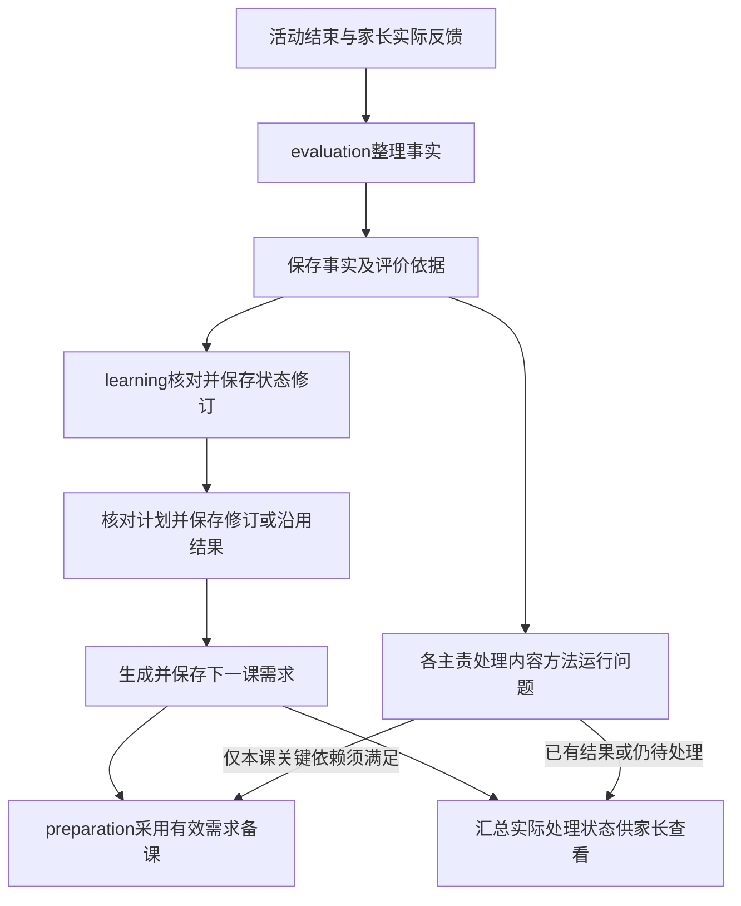

# 跨模块执行顺序与失败接续

文档版本：1.0.0；更新：2026年10月12日；范围：逻辑执行设计，未实现。

应用层协调一次请求从受理到结果、必要等待及失败接续。八个模块各自维护业务判断，协调职责只安排顺序、输入版本、结果和下一步，不评分、不维护第二份档案、不要求独立服务或新Agent。

## 用例协调与共同结果

interface发起准备下一课、开课、结束反馈或事实更正等用例，应用层调用业务模块，platform提供能力/存储，实际结果回到界面。业务信息流可以形成学习闭环，但模块不必互相循环调用才能完成一次操作。

每次操作关联原身份、活动/需求、来源修订、各步采用的有效版本、实际完成/保存范围、待输入/决定/失败和下一步。备课/课后可保存处理进度；课中及待反馈仍只用必要内存，不以协调台账新增快照或磁盘活动草稿。

“未生成”“已生成未保存”“保存未知”“已保存未落实”“生效”“沿用原版已核对”分别报告。同一来源/操作重试先查已知处理结果，接续失败步骤，不能重做已成功业务更新或另计活动。技术恢复不改发生日期。

## 准备与启动顺序

| 步骤 | 主责及结果 | 继续条件 |
| --- | --- | --- |
| 1. 形成需求 | learning读取当前有效档案/状态/计划，生成或复核需求 | 正式采用的需求已保存；待处理信息与允许范围明示 |
| 2. 编制课程 | preparation选相关Jane方法和内容，生成任务/素材/简报 | 只采用实际版本与必要资料，不静默改主目标 |
| 3. 固定并核验 | curriculum保存实际内容/依赖，preparation核验并修订 | 关键内容/素材/执行依据及保存完整；失败保持缺口 |
| 4. 家长预览 | interface呈现同版本安排，业务接收实际条件/必要决定 | 预览、阅读、决定分开；有影响变化回到需求/备课复核 |
| 5. 本次检查 | classroom联合platform/interface核对当前条件 | 内容适用、能力/材料/退出及数据条件具备，家长明确开始 |
| 6. 本堂执行 | classroom绑定版本，interface交付，platform提供能力 | 只核心推进，实际输入/帮助/交付在内存，停止优先 |

已备好内容不自动变成本次可开课。开始重复点击或连接重建沿用原操作/活动，不新建课堂。备课保存失败不影响无关旧成果，但缺失关键依赖的包不能进入。

## 课后顺序与生效条件

| 步骤 | 业务结果 | 保存失败或未知时 |
| --- | --- | --- |
| 1. 来源核对 | evaluation确认结束/反馈、活动类型、事实和未知 | 待关键澄清不阻塞无关有据部分，不填完整成绩 |
| 2. 事实保存 | 原活动/记录修订、原答/帮助/交付/结束及来源 | 不声称归档；尚未保存来源不能派生正式新状态 |
| 3. 评价依据保存 | 任务解释、限制、课堂对照、建议和问题引用 | 可显示草案，正式状态更新等待可用已保存依据 |
| 4. 状态落实 | learning复用依据、核对适用性/重复并保存修订或无变化结果 | 不把内存拟议当有效新状态，不发布依赖它的正式需求 |
| 5. 计划核对 | 按有效状态局部调整，或确认原计划仍适用 | 新计划未保存不宣称调整；不继续依赖失败修订 |
| 6. 需求保存 | 连接有效状态/计划/条件，说明基本目标/帮助和缺口 | 未保存仅作暂定草案，备课不冒称正式采用 |
| 7. 汇总结果 | evaluation组织家长报告，interface显示实际落实/待处理及下节预期 | 汇总失败不撤销已保存事实/状态，恢复汇总即可 |

图表示成功主路径，任一步失败按下表接续；协调取得各步实际完成或待处理状态即可汇总，不等待候选改进或未解决步骤全部成功。evaluation的评价依据是下游输入，家长汇总报告采用下游实际结果，不互相等待。无相应样本时learning可返回不更新哪些维度及原因；计划无需改动则返回沿用版本/适用范围，不为空改版本或虚构进步。

teacher候选改进、内容修订和运行修复分别交主责并回连原问题。非关键候选不阻塞全部下一课，也不等待长期效果才提供家长报告；本课关键内容/方法/能力问题必须先修复或有核实替代，才允许相关使用。重大方向/预算/主要方式变更形成具体方案等待家长，其他已授权步骤继续。

正式数据更新以上述保存条件为准；单堂核心状态仍按必要内存立即执行。不能为了完成课后事务让停止等待、重放旧输入、回滚全部后来记录，或把多个保存步骤说成原子全成功。具体一致性机制后续选择。

## 待反馈延后与内存丢失

首版默认在活动结束后的当次使用中提交一段反馈，可明确“无额外补充”。未反馈不自动整理或落盘活动，界面说明尚未归档及关闭/进程丢失风险，不强迫逐题反馈、完整转写或补测。

选择稍后反馈时，只在当前进程仍有必要内存的范围保留，不承诺关闭/重启恢复，不设隐藏磁盘草稿或后台录音。界面刷新与核心是否仍在分开核对。可用内存的保留/清理和服务退出要明确可见，本轮不设无限保留承诺或擅自增加持久化。

内存丢失后取得的家长实际报告可按真实来源补充评价，清楚标明直接课堂记录缺失，不从教案恢复原话/帮助/离屏。无法取回活动身份时核对实际日期、内容和同次关系；待核对的补记不冒称完整恢复或直接重复计样本。

上一课待反馈时可以基于已保存状态与计划形成暂定下一课。若拟采用旧有效需求进入正式备课/课堂，须由learning明确它仍适用、不依赖未归档表现，preparation复核相关材料熟悉度和缺口，再走本次检查；不能自动推定上一课已完成或阻断所有无关活动。

## 失败接续与更正

| 情况 | 接续责任和路径 |
| --- | --- |
| 结果已生成但保存失败 | 原维护者在原对象/操作保存，不重新生成事实或重复活动；丢失时标缺口 |
| 保存结果未知 | platform提供核对能力，应用层先核对原操作再有限接续；不猜未写入后创建新对象 |
| 状态已保存但计划/需求失败 | 保留有效新状态；learning重核当前计划与新增依据，完成原步骤，报告分项状态 |
| 旧对象仍有效且失败结果不相关 | learning/接收业务明确适用范围后可沿用，不能由UI自行切旧版绕过关键问题 |
| 两次处理或新的来源修订 | 已完成同修订不再执行；新修订从原活动更正并复核受影响步骤 |
| 处理期间已有更新状态/计划 | 核对当前基线及新依据，重算相关影响，不覆盖后来的事实或盲目回滚 |
| 内容/原答/帮助更正 | evaluation保存原来源/新解释，learning回查依赖状态/计划，相关包待复核；不重放课堂 |
| 汇总报告或非关键改进失败 | 已生效业务保持，重做对应汇总/改进步骤，不全链重跑 |
| 重要决定待家长 | 阻断依赖该方案的生效；其他已有授权且独立的操作不增加审批 |

来源更正可能使原依据不再适用。已知关键疑点须限制受影响后续使用，即使完整更正链尚未完成，也不能以旧“已保存”当无问题；具体限制由业务维护者提出，curriculum/应用层连接使用范围，历史仍保留。

## 版本适用性与复核责任

| 变化 | 谁提出影响 | 谁落实与解除限制 |
| --- | --- | --- |
| 状态、家庭条件、目标或材料经历 | learning标明相关范围与新修订 | preparation复核课程；关键需求由learning修订，classroom采用有效启动依据 |
| Jane候选方法 | teacher说明候选/检查范围 | preparation选择已检查且适用的实际版本；候选不自动废弃旧版 |
| 已知关键方法缺陷 | teacher/classroom/evaluation按有据问题提出限制 | teacher修方法或preparation用核实替代，复核相关流程后解除对应限制 |
| 内容、答案、素材或外部依赖错误/失效 | preparation/curriculum记录对象与范围 | curriculum保存限制/依赖，preparation修包，evaluation/learning回查结论 |
| 模型、声音、媒介、设备或数据条件 | platform/interface报告实际变化 | classroom联合核对当前条件，preparation复核受影响任务/检查 |
| 能力定义/映射修订 | learning按目录给出受影响引用 | evaluation复核解释、learning状态映射、preparation课程目标，保留历史 |

共享影响记录连接变更源、对象版本、受影响目标/任务/检查、主责/关联、待复核/限制及解除依据。无影响有理由地沿用，不因任何新版本出现就全部失效。curriculum固定旧内容并保存附加限制/核验修订，不通过覆盖原包解除问题；启动采用明确有效范围。

## 下一课的继续条件

| 层次 | 可以做什么 | 必须具备 |
| --- | --- | --- |
| 暂定探索/草案 | 选候选、拟目标、预览未完成内容 | 只用有据已保存基线，待反馈/失败和假设明示，不宣称就绪 |
| 正式备课完成 | 编制并核验实际课程包 | 采用已保存且复核适用的需求；关键内容/素材/方法/保存具备，无阻断性决定或疑点 |
| 本次可开课 | 进入绑定课堂 | 上述包及需求仍适用，当前材料/能力/停止/数据与家庭条件具备，相应验收及家长明确开始 |

并非上一课全部题完成、正常收尾确认或每项改进关闭才可继续。影响本课的事实/评价/状态/计划失败、关键更正或适用性未解决时，仅相关路径保持草案/待复核。沿用旧基线必须有业务适用结果，不是失败自动退回旧版本。

上课后正常收尾、未确认、明确停止和中断各自结束；所有分支都可在实际反馈后形成有据部分及下一课需求，不能以补齐教案或生成完整报告为继续条件。

## 家庭数据权威的阶段切换

当前设计/成人原型阶段，LearningWithAI继续维护真实档案与历史，J不接管、不迁移或回写；用例案例仅模拟。正式接入目标是J的learning/evaluation管理接入后新状态/计划和真实记录，旧项目作为只读历史来源。

切换前明确采用哪些最小档案/当前状态/计划和必要证据，保存旧来源、身份/日期/修订映射与可获取引用，核对成人/儿童分类、更正和重复。处理仍未完成的更新或冲突，明确切换边界及唯一写入入口；同时满足数据条件、正式功能验收和家长对具体接入范围的明确采用。

未完成切换不称真实闭环已接入。旧项目保留历史原件，不建立两端自动双写；同一真实事件沿原权威来源接续。具体迁移实施另行授权和验证，本轮不操作家庭数据。旧关系见[legacy-import.md](../../docs/legacy-import.md)，未来验证见[端到端案例](end-to-end-cases.md)。
