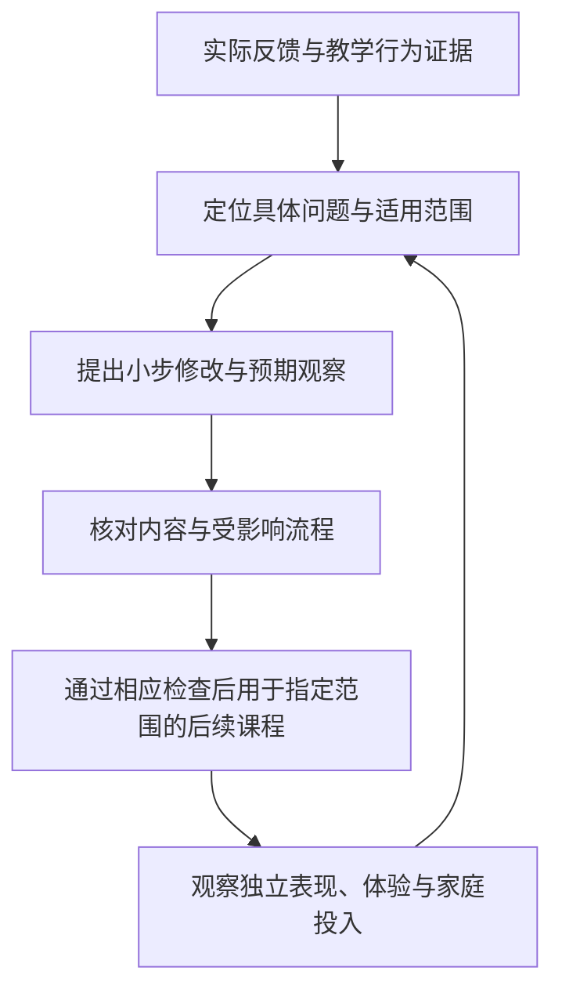

# Jane 的反馈迭代与版本管理

文档版本：1.3.0；更新：2026年10月12日；范围：逻辑设计，未实现。

Jane通过反馈持续改进方法，保持唯一身份。当前设计中的迭代是教学规则、策略、配置和备课适配的有依据修订，不表示自动训练模型、功能已经上线或教学效果已证明。

## 反馈来源与归因

输入来自结束后的实际教学事件、家长一次反馈、必要作品与学生原话、课后评价和相关历史。成人演练可以验证流程或提供成人体验，但不能作为孩子能力与教学效果证据。课中不为改进额外监控、录屏、存快照或填写评分表。

| 需要关注什么 | 依据与可能的处理 |
| --- | --- |
| 提问与说明 | 实际任务是否清楚、是否连问或长篇讲解；可检查措辞、节奏及任务拆分 |
| 求助变化 | 实际困难、两次帮助和再次尝试；只换措辞时准备不同表征或步骤 |
| 纠错与判断 | 原答、课程依据、实际反馈与再试；先区分材料/rubric问题、输入识别、模型判断和教师表达 |
| 独立表现 | 提示撤去后的实际条件与结果；教师讲得顺或学生跟读不表示会独立做 |
| 保持与迁移 | 有真实间隔或相近新情境的样本才判断，缺少时保留未知 |
| 体验与投入 | 孩子原话、家长实际准备/陪伴负担；偏好不固定成性格或永久方法 |
| 流程与运行 | 目标、等待、离屏、结束的实际事件；播放、接口和时延故障交对应模块，不归为学生学习问题 |

评价分别解释学生表现和教学行为，保留事实、AI解释与假设。一次困难不证明某方法无效，连续相关表现也不自动证明因果；材料熟悉度、帮助和任务条件等替代解释应注明。已知的规则违背可立即提出修正，不必等积累多次失败。

按[评价课堂对照](../evaluation/lesson-alignment.md)核对绑定方法、计划与实际、许可/原因/影响和主责关联；允许支持/停止造成差异不自动判方法失效。采用[评价交接](../evaluation/handoffs.md)的具体行为与版本提出修改，不复制原事实或改学生状态；处理结果/验证范围回连原问题，更正评价时重审依赖方法建议，不宣称尚未实施的改进已有效。

## 小步迭代流程

1. 明确问题：关联实际事件、所用Jane/策略/课程版本与条件，不写泛泛“更有耐心”。
2. 定位范围：本课材料、选用策略、通用方法还是运行故障；只改相关责任范围。
3. 准备具体修改：通常一次改变一种行为，说明为什么、预计改善什么、怎样发现无效和怎样退出。
4. 验证影响：检查内容和原规则兼容，用明确模拟及必要成人实际检查验证受影响分支；未做项保留未验证。重大流程变化需完整演练，范围匹配而不重复无关检查。
5. 用于后续课程：通过所需检查后以明确版本和适用范围绑定，记录正式实施仍待哪些条件；不热更新正在进行的课堂。
6. 复查效果：在真实后续反馈中观察独立理解/应用、保持/迁移、体验与投入，决定维持、缩小范围、改法或停止使用。没有新反馈不宣称改善。

常规有依据的方法小调整可在已授权范围内推进，并向家长解释；长期方向、学科优先级、固定预算、主要教学方式或主要评价方式变化先形成具体方案交家长决定。不要求家长逐项批准话术或手工给教师评分；复查可结合周/阶段复盘，不额外创建自动化任务。

候选与已验证适用方法、关键缺陷的下一课处理按[共同执行](../shared/execution-recovery.md)区分：候选未完成不阻塞所有课，已知缺陷限制对应路径并核验替代/修复。问题引用及指定范围修复、效果待复查采用[共同合同](../shared/business-contracts.md)，不能启用即称改善。

## 三类变化

| 变化 | 版本与验证 |
| --- | --- |
| 本课允许的即时适配 | 在已绑定策略中调整说明、帮助和节奏；保留实际动作与帮助，不产生全局新版本 |
| Jane的持续行为改进 | 修订规则、策略或表达配置，保留依据、范围、检查和版本，影响未来备课 |
| 平台、内容或评价依据变化 | 交对应模块处理并核对相关绑定；不能由教师风格静默改变答案、评分或实际模型参数 |

## 版本组织

- Jane身份始终唯一。文档版本、Jane教学配置版本、策略版本、课程与教师简报版本分别标识；当前设计文档1.0.0不表示已启用Jane教学配置1.0.0。
- Jane教学配置记录稳定角色、通用规则引用、允许策略及其版本、适用范围与改进依据；具体标识与存储格式后续确定。
- 每个课程绑定实际Jane配置、选用策略版本和本课简报；简报包含学习状态/需求引用及本课内容，不能仅引用可变化的“最新Jane”。
- 备课期间新版本出现时判断是否影响该课，修订受影响部分并核对就绪依据；已实施课程保留当时版本。课堂中不写全局配置或自动更换版本。
- 候选、已检查可在指定范围使用、暂停/被替代等使用状态与检查范围分开保存。发布或启用只说明指定条件可使用，不证明儿童长期效果。
- 不适用时停止在未来课程中选用该策略或恢复先前适用配置，保留修改与原因；不删除后来的真实记录、不改写历史或在课中切换全局配置。
- 改进记录只引用必要证据，由evaluation维护原事实，learning维护学生状态；不复制原始音视频或另建学生档案。

稳定尊重、真实性、停止、分维度证据和独立条件不能因偏好或单次反馈被撤销。策略、简报和课程版本的一致性见[模块交接](handoffs.md)。

## 运行变化与替代解释

评价和方法改进必须核对实际模型标识/可取得版本、用途参数、上下文编排、输入提交策略、识别与合成配置、材料和帮助条件。platform提供可查变化，evaluation说明它们可能影响的行为范围，teacher在归因与复查方案中采用。

同名模型或未披露版本变化不能排除服务端行为变化，也不能直接断言已经发生漂移。出现异常时保留运行原因未知，用固定的虚构语义/帮助案例及必要成人语音复核受影响能力；不额外监控儿童课堂。已知行为回归按影响限制使用，原孩子证据不自动变成能力退步；后续恢复采用[验收范围](../application/acceptance.md)和实际检查依据。
